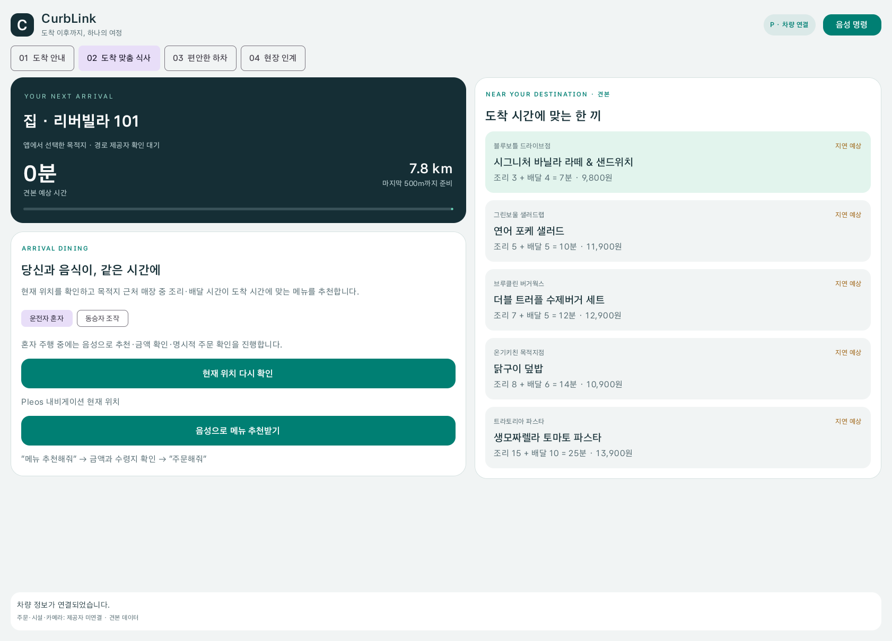
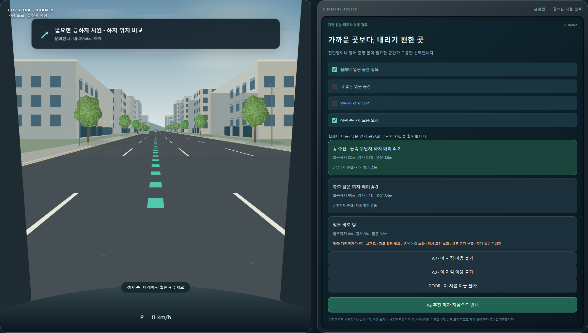

> **simulation — 웹 도로·차량 내부·주변 시야 시뮬레이션**

# CurbLink Drive 0.5.2

도착 이후의 식사·편안한 하차·현장 인계를 준비하는 네이티브 차량 앱과 별도 웹 주행 시뮬레이터입니다.

[main](https://github.com/leechanghwanspace/Pleos-CurbLink/tree/main) · [simulation](https://github.com/leechanghwanspace/Pleos-CurbLink/tree/simulation) · [integration](https://github.com/leechanghwanspace/Pleos-CurbLink/tree/integration) · [apk](https://github.com/leechanghwanspace/Pleos-CurbLink/tree/apk)

## 다운로드와 검증

- **[차량 앱 APK — 0.5.2-arrival-preview](release/CurbLink-Drive-0.5.2-arrival-preview.apk)** · [SHA-256](release/CurbLink-Drive-0.5.2-arrival-preview.apk.sha256)
- [이번 검증 기록](release/VERIFICATION-0.5.2.json) · [변경·남은 검증](docs/UPDATE_0_5_2.md) · [캡처 출처](captures/README.md)
- versionCode **8** / Android 10 이상 / Automotive 기기 필수 / debug 서명 프리뷰. 기존 설치본과 서명이 다르면 데이터를 삭제하지 말고 인증서를 확인하세요.
- 기존 [0.5.1 APK](release/CurbLink-Drive-0.5.1-arrival-studio.apk)와 [0.5.1 웹 UI 목업](release/CurbLink-Drive-0.5.1-mockup.html)은 이전 버전입니다. 목업은 실제 APK·도로 시뮬레이션 증거가 아닙니다.

차선의 다음 행동·인접 변경 준비·관측에 근거한 이유, 이용 불가 하차 후보의 대안·새 승인, GPS·음성·사진·공유 실패 후 선택 보존과 재시도 안내를 반영했습니다.

| 검증 | 결과와 범위 |
|---|---|
| Android 빌드·시험 컴파일·lint | 통과 · 오류 0 / 기존 의존성 갱신 경고 3 |
| JVM 규칙 시험 | 80개 통과 |
| Pleos 외부 시험 드라이버 | 18흐름·94조건 통과 · 시험용 관측 입력 |
| Pleos 실제 서비스 IPC | CarService·NaviHelper 연결·재연결 등 16조건 통과 |
| 웹 도로 시뮬레이션 | 여섯 여정 완료·원본 PNG 9장·브라우저 오류 없음 |
| 웹 복구 화면 | A-2 제외→A-3, 후보 없음, 새 승인, 840/480 폭 확인 |
| 제품 APK 경계·서명·정렬 | 시뮬레이션/시험 코드 제외·v2 서명·16KB 정렬 통과 |

사용자 요청으로 검증된 프리뷰 소스를 main에 반영했습니다. **실제 STT/TTS·사진 선택기/공유 대상 전달·TalkBack/로터리·공식 폼팩터는 추가 확인 대상**입니다. 실차 인증·마켓 심사 완료 버전은 아닙니다.

## 최신 차량 앱 화면 — 0.5.2

Pleos Connect 2.1.0에서 실제 APK를 실행하고 **Android PixelCopy 앱 창 원본 1682×1210 PNG**로 촬영했습니다. [원본·해시·입력 출처](captures/android/0.5.2/verification.json)

차선·하차 대안 화면은 별도 시험 APK의 TEST 관측을 사용합니다. 식사·시설은 견본 데이터이며 실제 주문·결제·시설 제공자 연결 증거가 아닙니다.

| 도착 안내 · 목표 4차선과 다음 인접 3차선 준비 | 식사 · 목적지 근처 견본 매장 |
|---|---|
|  |  |

| 편안한 하차 · 지원 조건·후보 비교 | 현장 인계 · 위치 카드 |
|---|---|
|  |  |

| A-2 이용 불가 → A-3 대안 | 조건에 맞는 후보 없음 |
|---|---|
|  |  |

[실제 플랫폼 연결 화면](captures/android/0.5.2/01-platform-connected.png) · [주문 검토](captures/android/0.5.2/03-dining-review.png) · [하차 완료 확인](captures/android/0.5.2/05-access-completed.png)

CarService 기어·UX 제한 및 NaviHelper 서비스 IPC를 연결했습니다. 이번 실행에서는 선택한 견본 목적지에 일치하는 활성 경로가 없어 `routeReady=false`였습니다. 실제 목적지 경로·ETA 수신 완료로 해석하지 않습니다. 차선/신호/정체·실제 POI 경로 생성·주문/결제·시설·SVM·도어/리프트 제공자는 미연결입니다.

## 최신 웹 시뮬레이션 — 여섯 여정 검증

`simulator/`의 **가상 도로·차량 내부·합성 주변 시야**입니다. 1920×1200 뷰포트·배율 1에서 요소 영역의 원본 PNG를 수집했습니다. 소프트웨어 렌더링 검증으로 물리 GPU·실차 성능 검증은 아닙니다. [여정 결과·원본 크기·해시](captures/web/0.5.2/verification.json)

| 골목 픽업 · 승객 탑승 후 본선 복귀 | 주차 · R단 후진 후 P단 정렬 |
|---|---|
|  |  |


| 식사 메뉴 · 혼자 운전 시 터치 주문 차단 | 명시적 모의 음성 주문 후 음식·차량 도착 비교 |
|---|---|
|  |  |


| 하차 후보 비교 | P단 정차 후 공간·장비·직원 확인 |
|---|---|
|  |  |

[입구 도착 완료 원본](captures/web/0.5.2/09-access-complete.png) · [이용 불가 후보·좁은 화면 복구 검증](captures/web/ux-followup-2026-10-30/verification.json)

픽업·주차·잠시 정차는 출발부터 종료까지, 식사·한강 인계는 명시적 확인과 수령까지, 배리어프리는 안전 조건 확인과 입구 도착까지 검증했습니다. **앱과 웹 동시 실행은 실시간 상태 동기화를 의미하지 않습니다.**

## 실행과 빌드

JDK17 / Gradle wrapper 8.9 / Android SDK35 / Python3 / 웹 규칙 시험용 Node.js를 사용합니다. Pleos AVD는 별도로 부팅하고 `adb devices`의 장치를 지정하세요.

```powershell
. ./scripts/use-home-env.ps1
# 웹 도로 시뮬레이션만
./scripts/start-experience.ps1 -Mode Simulation -OpenBrowser
# APK만 (다른 터미널)
./scripts/start-experience.ps1 -Mode Apk -Serial emulator-5554
# 앱과 웹 동시 실행
./scripts/start-experience.ps1 -Mode Integrated -Serial emulator-5554 -OpenBrowser
```

```powershell
./scripts/build-drive.ps1
# 브라우저 설치는 첫 검증 환경에서 한 번 수행
python -m pip install playwright
python -m playwright install chromium
python scripts/verify-simulation.py
python scripts/verify-ux-simulator.py
```

`build-drive.ps1`는 현재 0.5.2 APK/해시를 재생성합니다. 재빌드하면 바이트·서명·해시가 달라질 수 있습니다. 이전 버전은 보존합니다.

## 구조와 이어가기

- `app/src/main`: 네이티브 차량 UI·상태·안전 규칙·실제 플랫폼 읽기 어댑터.
- `simulator/`: 별도 웹 도로/식사/하차/합성 주변 시야 시뮬레이션.
- `app/src/androidTest`, `app/src/testSupport`: 외부 시험 드라이버·시나리오. 제품 APK에 미포함.
- [브랜치 역할](docs/BRANCH_GUIDE.md) · [이번 게시 기록](docs/UPDATE_0_5_2.md) · [안티그래피 인수인계](docs/ANTIGRAVITY_HANDOFF.md) · [이전 작업 기록](docs/UX_CONTINUATION_2026_10_30.md).

기존 0.2/0.3/0.4/0.5/0.5.1 APK와 캡처는 이력으로 보존합니다. 현재 화면과 검증은 위 0.5.2 자료를 기준으로 확인하세요.
