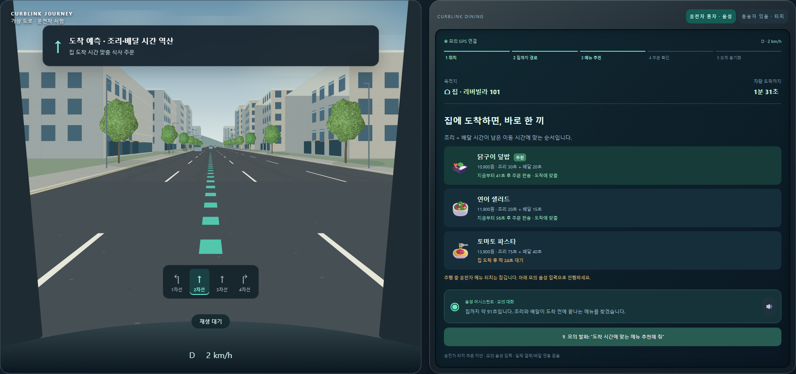

# CurbLink · 웹 시뮬레이션

> **현재 브랜치: `simulation` — 도로·차량·주변 시야 웹 시뮬레이션 개발**
>
> [최종 main](https://github.com/leechanghwanspace/Pleos-CurbLink/tree/main) · **시뮬레이션** · [통합 개발](https://github.com/leechanghwanspace/Pleos-CurbLink/tree/integration) · [APK 단독](https://github.com/leechanghwanspace/Pleos-CurbLink/tree/apk)
>
> [브랜치 역할과 개발 규칙](docs/BRANCH_GUIDE.md) · [0.5.1 안정성 수정](docs/UPDATE_0_5_1.md)

이 브랜치에서는 아래 이미지의 **도로 주행·차선·차량 내부 주문·배리어프리 하차·주변 시야 인계**를 중심으로 시뮬레이션을 개발합니다. `release/studio/`의 대시보드 목업과 다른 실행 화면입니다. 네이티브 APK 실행 화면이 아닙니다.

## 실행

저장소 루트에서 Python3로 실행합니다. 무거운 Pleos 에뮬레이터를 자동 실행하지 않습니다.

```powershell
./scripts/start-experience.ps1 -Mode Simulation -OpenBrowser
# 또는 python -m http.server 8000 --bind 127.0.0.1
```

브라우저 주소: <http://127.0.0.1:8000/simulator/>. 기존 React·Babel·Tailwind CDN을 사용하므로 인터넷 연결이 필요합니다. 실행 포트가 사용 중이면 `-Port 8001`처럼 다른 포트를 선택합니다.

## 시뮬레이션 기준 화면

아래는 기존 웹 시뮬레이터 참고 캡처입니다. 네이티브 APK 실행 화면이 아니며, 새 버전의 실시간 실행·재촬영 증거가 아닙니다. 이전 외관/트렁크 인터록 화면은 웹 진입 화면에서 제거했습니다.

### 도로·차선·운전자 시점


1차선 좌회전, 2차선 직좌 혼용, 3차선 직진, 4차선 직우·정차 혼잡을 고려합니다. 공통 비용 규칙에 직좌 동시 신호 비교, 분기점 조기 준비, 늦은 진입 시 재탐색 조건을 추가했습니다. 실제 도로 교통 정보나 주행 제어는 아닙니다.

### 차량 내부에서 도착 맞춤 식사




### 배리어프리 하차와 입구 이동


### 현장 인계와 주변 시야


카메라는 합성 장면이며 실제 SVM 촬영이 아닙니다.

## 여섯 여정

| 선택 | 흐름 |
|---|---|
| 1 골목 픽업 | 우회전 → 탑승 → 회차 → 본선 복귀 |
| 2 일반 주차 | 주차장 진입 → 통로 → 후진 주차 |
| 3 잠시 정차 | 도로변 접근 → 정차 → 재합류 |
| 4 식사 시간 맞춤 | 현재 위치·ETA → 메뉴·명시적 주문 → 집·음식 도착 |
| 5 한강 현장 인계 | 주변 시야 → 위치 확인 → 인계 |
| 6 배리어프리 하차 | 지원·베이 비교 → 정차·승인 → 무단차 입구 이동 |

## 개발 위치와 검증

`simulator/index.html`, `simulator/js/mission-engine.js`, `lane-engine.js`, `mission-viewport.jsx`, `driver-viewport.jsx`, `meal-cabin.jsx`, `access-cabin.jsx`를 우선 확인합니다. 공통 변경은 `integration`에 합류시켜 APK 규칙과 대조합니다.

JavaScript 규칙 시험 5파일은 통과했습니다. 이번 회사 PC에서는 GPU 시뮬레이션의 실제 장면을 실행·재촬영하지 않았습니다. 집 PC에서 동작·프레임·전체 여정을 확인하고 캡처와 영상을 갱신합니다.

APK 설치·앱 UI 개발이 목적이면 [apk 브랜치](https://github.com/leechanghwanspace/Pleos-CurbLink/tree/apk)를 사용하세요. 공통 소스는 이력 일관성을 위해 보존하지만 이 브랜치의 기본 실행은 웹 시뮬레이션입니다.
