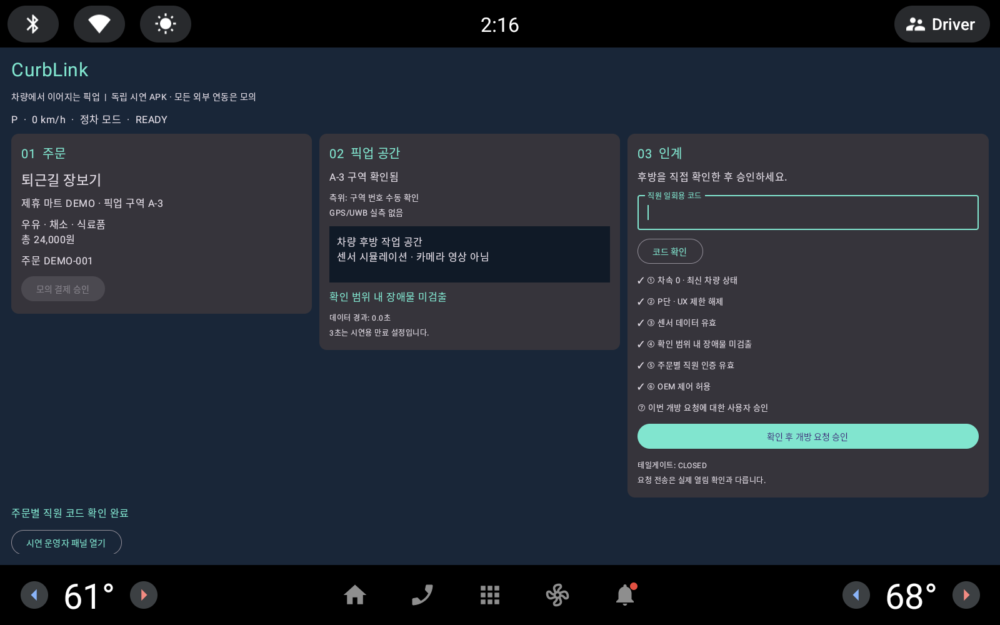
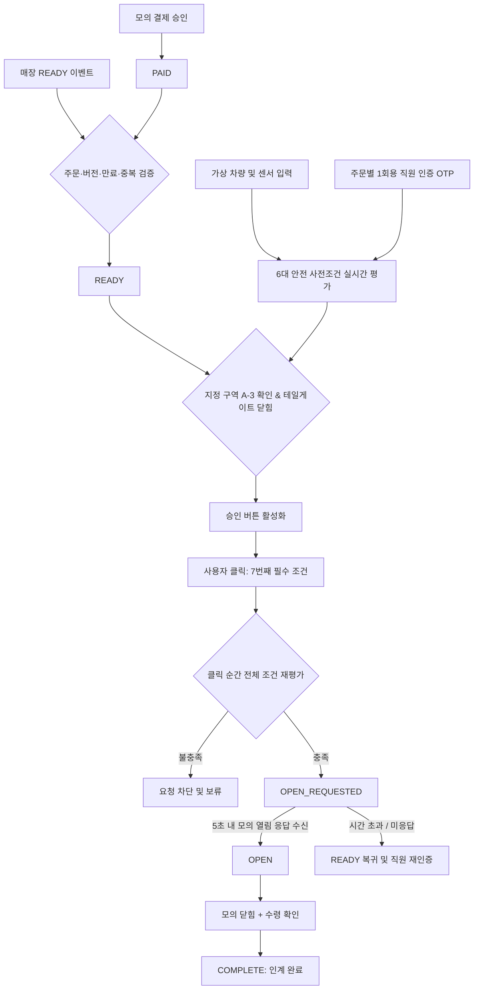

# 🚗 Pleos CurbLink · 플레오스 커브링크

> **차량 상태와 센서 인터록 기반의 비하차 신뢰 인계(Trusted Handoff) 커넥티드 서비스**  
> *현대자동차그룹 오픈 앱 개발 공모전(HMG App Dev Challenge) 출품작 · 1인 개발 프로토타입*

---

[](https://source.android.com/docs/automotive)
[-blue)](https://developer.android.com/)
[](https://developer.android.com/jetpack/compose)
[](docs/검증결과.txt)
[](release/Pleos-CurbLink-demo.apk)

---

## 📌 1. 프로젝트 개요 (Overview)

**Pleos CurbLink**는 차량 내 음성 주문 요청과 매장 준비 상태를 **차량의 주차(P단)·차속·센서 인터록·사용자 승인 조건**과 유기적으로 결합하여, 지정된 픽업 공간(커브사이드)에서 **운전자의 하차 없이 테일게이트를 통해 안전하게 물품을 수령**할 수 있도록 지원하는 Pleos Connect 네이티브 앱 프로토타입입니다.

### 💡 기획 배경 및 문제 정의
- **퇴근길 픽업 및 돌봄 차량의 페인포인트**: 영유아나 고령자가 동승한 차량의 경우, 매장 방문 수령을 위한 잠시의 하차도 위험한 돌봄의 중단으로 이어집니다.
- **기존 모바일 앱의 한계**: 스마트폰 화면 중심 앱은 차량의 기어(P/D), 차속, 주변 장애물, 트렁크 개방 상태와 결합할 수 없어 운전자의 수동 시각 분산을 유발합니다.
- **CurbLink의 해결책**: **‘매장 준비 완료 → 지정 구역 도착 → 6개 안전 인터록 검증 → 사용자 최종 승인 → 인계 완료’**의 폐루프 상태 머신을 구축하여 안전성과 편의성을 동시에 확보합니다.

> ⚠️ **시연 범위 안내 (Important Notice)**  
> 본 결과물은 **독립 실행 가능한 시연용 데모 앱(v0.1-demo)**입니다. 실제 Pleos SDK, Gleo 음성, CarPay, GPS/UWB, SVM 실차 하드웨어는 시연을 위해 모의 입력(Simulated Adapter)으로 구성되어 있으며, 양산 전 OEM 공식 안전 인증 및 실차 시험이 필요한 프로토타입입니다.

---

## 🖼️ 2. 실제 AAOS 구동 캡처 (Screen Walkthrough)

*Android Automotive OS (API 33, Google Automotive 시스템 이미지, 1600×1000) 실제 실행 화면*

| 01. 정차 중 주문/결제 | 02. 주행 중 조작 잠금 |
|:---:|:---:|
|  |  |
| **P단 & 0km/h**: 주문 요약, 결제 승인, 안전 사전조건 실시간 표시 | **가상 D단 & 40km/h**: 운전자 주의분산 방지 전체 화면 마스킹 |
| **03. 장애물 감지 시 개방 보류** | **04. 6대 안전조건 충족 & 승인 준비** |
|  |  |
| 후방 센서 장애물 감지 또는 3초 만료 시 개방 버튼 비활성화 | 전 조건 충족 및 6자리 OTP 인증 완료 시 사용자 승인 버튼 활성화 |
| **05. 테일게이트 개방 및 인계 완료** | **06. 신호 대기 중 조작 잠금 유지** |
|  |  |
| 사용자 명시 승인 → 열림 응답 → 수령 확인 후 여정 완료 | **D단 & 0km/h**: 정차 중이라도 D단이면 잠금 상태를 철저히 유지 |

---

## 🛡️ 3. 안전 인터록 및 상태 머신 아키텍처



### 🔒 6+1 안전 사전조건 (Prerequisites)
1. **차속 0 & 최신 차량 상태**: 유효 차속 0.0 km/h 및 1초 이내 단조 시계(`SystemClock.elapsedRealtime()`) 갱신
2. **P단 & UX 제한 해제**: 기어가 P단이며 AAOS Car UX Restrictions가 해제된 상태
3. **센서 데이터 유효성**: 최근 3.0초 이내에 갱신된 센서 스트림
4. **장애물 미검출**: 확인된 후방 작업 범위 내 장애물 미검출(`CLEAR_IN_VERIFIED_RANGE`)
5. **주문별 직원 인증 유효**: 주문 ID 및 리비전에 귀속된 6자리 일회용 코드 (60초 유효, 5회 실패 시 차단)
6. **OEM 제어 권한 허용**: 차량 제어기 인터록 허용 상태
7. **사용자의 명시적 승인 (7th Condition)**: 사전 조건 만족 시 버튼이 활성화되며, **클릭 순간 전체 조건을 재평가**하여 승인합니다. (원격 개방 또는 승인 선저장 불가)

---

## ⚡ 4. 빠른 시작 가이드 (Quick Start)

### 📲 APK 직접 설치 및 120초 시연 순서
1. [release/Pleos-CurbLink-demo.apk](release/Pleos-CurbLink-demo.apk)를 Android 10(API 29) 이상의 기기 또는 에뮬레이터에 설치합니다.
   ```powershell
   adb install -r release/Pleos-CurbLink-demo.apk
   ```
2. 앱 실행 후 **`모의 결제 승인`** 클릭 (PAID 상태 전환).
3. 우측 상단 **`시연 운영자 패널 열기`** → **`매장 준비 완료`** 클릭 → **`구역 확인 전환`** 클릭 (A-3 주차 확인).
4. **`직원 코드 발급`**으로 생성된 6자리 코드를 인계 화면에 입력 후 **`코드 확인`** 클릭.
5. 6개 사전 조건 충족 시 **`확인 후 개방 요청 승인`** 버튼이 활성화됩니다.
6. 버튼 클릭 후 5초 이내에 운영자 패널의 **`차량 열림 응답`** 클릭.
7. **`닫힘 + 수령 확인`**을 누르면 인계 여정이 성공적으로 완료됩니다.

---

## 🛠️ 5. 프로젝트 빌드 및 단위 테스트

### 기술 스택
- **언어 & 런타임**: Kotlin 2.0.21 / JDK 17
- **UI 프레임워크**: Jetpack Compose (BOM 2024.12.01) + Material 3
- **아키텍처**: Android Jetpack ViewModel + Kotlin Coroutines & StateFlow (단방향 UDF)
- **빌드 시스템**: Gradle 8.9 / Android Gradle Plugin 8.7.3
- **호환 환경**: compileSdk 35 / minSdk 29 (Android Automotive OS 호환)

### 소스코드 빌드
```powershell
# 프로젝트 클론 및 디버그 APK 빌드
./gradlew.bat assembleDebug

# 빌드 결과물: app/build/outputs/apk/debug/app-debug.apk
```

### 도메인 안전성 단위 테스트 (17개 케이스 전수 통과)
Windows 로컬 루프백 환경에서도 안정적으로 실행할 수 있도록 전용 테스트 스크립트를 제공합니다.
```powershell
# 도메인 엔진 단위 시험 컴파일 및 JUnitCore 직접 실행
./run-domain-tests.ps1
```
*테스트 커버리지*: 주행 잠금, 신호 대기 잠금, P단 해제, 센서 만료(3초), 장애물 진입, OEM 권한 거부, 중복 결제 멱등성, 원격 개방 이벤트 차단, 승인 전/후 상태 전이 등 17개 전 항목 통과 (상세 로그: [docs/검증결과.txt](docs/검증결과.txt)).

---

## 📂 6. 디렉토리 구조 (Repository Layout)

```text
Pleos-CurbLink/
├── README.md                           # 본 종합 가이드 및 아키텍처 명세
├── build.gradle.kts                    # 루트 Gradle 빌드 스크립트
├── settings.gradle.kts                 # 모듈 설정 (app)
├── gradle.properties                   # JVM/빌드 옵션
├── gradlew, gradlew.bat                # Gradle 래퍼 실행기
├── run-domain-tests.ps1                # 도메인 단위 시험 실행 스크립트
│
├── app/                                # AAOS 데모 애플리케이션 모듈
│   ├── build.gradle.kts
│   └── src/
│       ├── main/
│       │   ├── AndroidManifest.xml     # 앱 매니페스트 (가로모드, AAOS 대응)
│       │   └── java/io/curblink/demo/
│       │       ├── MainActivity.kt               # Compose 엔트리포인트
│       │       ├── CurbLinkMainScreen.kt         # 정차 UI, 주행 잠금, 운영자 서랍 패널
│       │       ├── CurbLinkViewModel.kt          # 상태 머신, 타이머, 모의 입력 제어
│       │       ├── CurbLinkModels.kt             # 차량/센서/주문 데이터 모델 및 인터페이스
│       │       └── SafetyAndPaymentEngines.kt    # 인터록 평가기, 멱등 결제 어댑터, 자가검사
│       └── test/java/io/curblink/demo/
│           └── DomainTest.kt                     # 17개 핵심 도메인 로직 단위 테스트
│
├── docs/                               # 공모전 제출 기획서 및 심사 자료
│   ├── 02_앱프로젝트소개_1인개발.txt    # HMG 공모전 심사자료 전문 (1인 개발 상세 기획)
│   ├── ARCHITECTURE.md                 # 상태 전이 및 실제 OEM 연동 선행조건 표
│   ├── 검증결과.txt                     # 단위 테스트 및 빌드 검증 보고서
│   └── test-results/
│       └── junit-direct.log            # JUnit 테스트 통과 로그
│
├── captures/                           # AAOS AVD 실제 구동 캡처 이미지
│   ├── 01-parked-order.png
│   ├── 02-driving-lock.png
│   ├── 03-obstacle-hold.png
│   ├── 04-handoff-ready.png
│   ├── 05-handoff-complete.png
│   ├── 06-signal-stop-lock.png
│   └── 캡처설명.txt
│
├── scripts/                            # 개발 및 검증 자동화 도구
│   ├── capture_android.py              # AVD UIAutomator 및 screencap 자동화
│   ├── package_curblink.py             # 산출물 패키징 및 SHA256 검증 스크립트
│   ├── ready_capture.py                # 캡처 준비 상태 주입 스크립트
│   └── setup_tools.py                  # 빌드 환경 설정 보조 도구
│
└── release/                            # 독립 시연용 릴리즈 바이너리
    ├── Pleos-CurbLink-demo.apk         # 시연용 디버그 APK (v0.1-demo)
    └── SHA256SUMS.txt                  # APK 무결성 해시 (SHA-256)
```

---

## 🔮 7. 향후 OEM 양산 연동 로드맵

| 연동 시스템 | 선행 필요 조건 | 검증 및 완료 증거 |
|:---|:---|:---|
| **Pleos Vehicle SDK** | 차종별 읽기/제어 권한 및 SDK 라이브러리 | Pleos 전용 AVD 및 허용 차량 신호 로그 |
| **Gleo AI 음성** | NLU Intent 등록 및 주행 중 음성 정책 승인 | 실제 발화 → Intent 바인딩 → 확인 청취 |
| **Hyundai CarPay** | 공식 가맹 제휴, 테스트 계정, 서명 콜백 | 실 거래 샌드박스, 이중청구 방지, 취소 환불 검증 |
| **SVM / 초음파 센서** | 카메라/센서 데이터 API 권한 및 보안 검증 | 렌즈 오염, 역광, 센서 통신 단절 Fail-Safe 시험 |
| **파워 테일게이트** | OEM 안전 인터록 및 끼임 방지 우회 불가 검증 | OEM 엔지니어 입회하 비상 정지/반전 실차 시험 |
| **UWB 측위** | 정밀 측위 앵커 및 차량 트랜시버 접근 권한 | 지정 주차면(A-3) 측위 오차 반경 0.5m 이내 검증 |

---

## 🔗 8. 공식 참고 자료
- [현대자동차그룹 오픈 앱 개발 공모전](https://appdevchallenge.auto-hmg.io/notice/c0a1a000-2026-4923-8000-000000000001)
- [Pleos Connect SDK Reference](https://document.pleos.ai/en/api-reference/connect-sdk-pleos/)
- [Android Automotive OS Driver Distraction Guidelines](https://source.android.com/docs/automotive/driver_distraction/guidelines)
- [NHTSA Visual-Manual Driver Distraction Guidelines](https://www.transportation.gov/regulations/federal-register-documents/2013-09883)
- [현대 카페이(Hyundai CarPay) 서비스 안내](https://www.hyundai.com/kr/ko/digital-customer-support/app/hyundai-car-pay/hyundai-car-pay-information)
