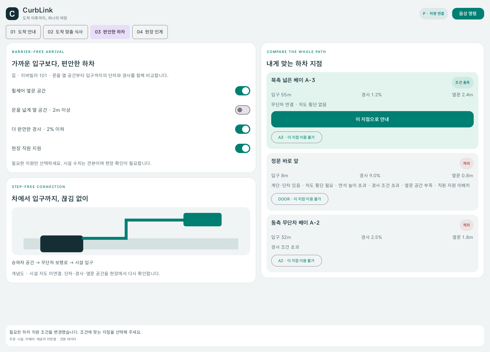
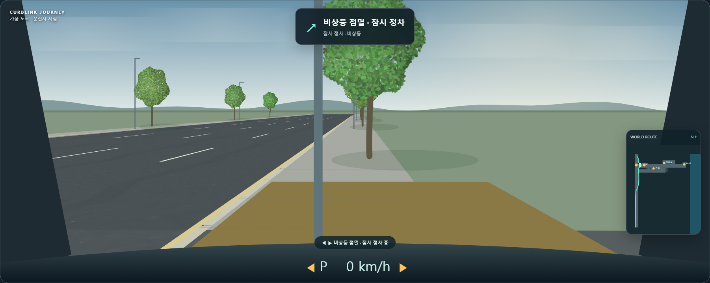
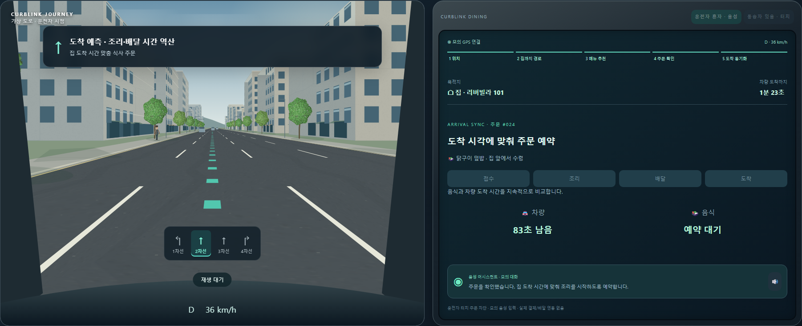
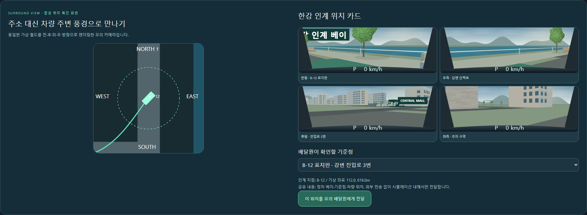
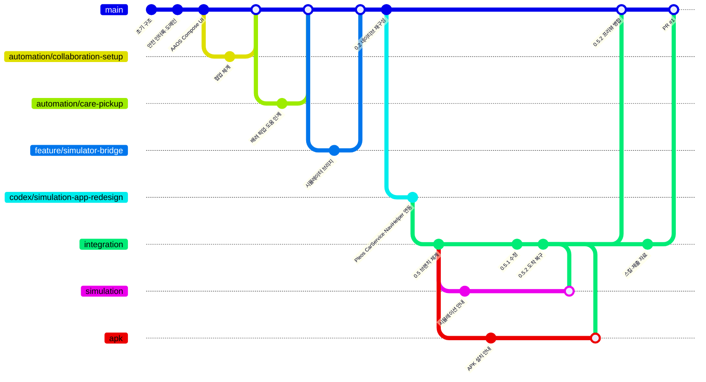

> **main — 공모전 제출 기준 최신 0.5.2 (release APK · 시연 영상 포함)**

# CurbLink Drive 0.5.2

주행 중 차량 상태를 읽어, **도착 이후**의 식사·편안한 하차·현장 인계를 안전하게 미리 준비하는 Pleos 차량용 앱입니다.

[주요 기능](#주요-기능) · [제출 정보](#공모전-제출-정보) · [앱 화면](#차량-앱-화면) · [검증 기록](#검증-기록) · [웹 시뮬레이션](#웹-주행-시뮬레이션--개발용-검증-환경) · [브랜치와 개발 이력](#브랜치-구성과-개발-이력)

## 주요 기능

| 기능 | 하는 일 |
|---|---|
| **01 도착 안내** | 차선별 대기열·신호·변경 횟수를 비교해 **다음 행동 / 남은 거리 / 추천 차선 / 한 줄 이유**를 안내. 정보가 없거나 만료되면 추천을 보류 |
| **02 도착 맞춤 식사** | 남은 주행 시간과 조리·배달 시간을 맞춰 메뉴를 추천하고 도착 시점에 맞춰 예약. 주행 중에는 **음성으로만** 주문 확정 |
| **03 편안한 하차** | 단차·경사·옆문 공간·직원 지원을 함께 비교해 하차 지점 추천. 이용할 수 없으면 대안 제시, 맞는 곳이 없으면 조건을 완화하지 않고 "후보 없음" 안내 |
| **04 현장 인계** | 전방·후방·좌측·우측 칸을 눌러 방향별 주변 사진을 고르고, 현재 GPS와 묶은 위치 카드를 공유. 위치나 사진이 바뀌면 이전 승인을 무효화 |
| **안전 원칙** | 차량 기어·속도·UX 제한을 실시간으로 읽어 **P단 정차일 때만** 터치 조작 허용. 차량 정보가 없거나 5초 넘게 갱신되지 않으면 조작을 막음 |

## 공모전 제출 정보

| 항목 | 내용 |
|---|---|
| 앱 이름 | **CurbLink Drive** (개인 참가 · 이창환, 일반 부문) |
| 한 줄 소개 | 주행 중 차량 상태를 읽어, 도착 이후의 식사·편안한 하차·현장 인계를 안전하게 미리 준비하는 차량용 앱 |
| APK | [`apk/이창환_CurbLink_release.apk`](apk/이창환_CurbLink_release.apk) · [SHA-256](apk/이창환_CurbLink_release.apk.sha256) · release 빌드(현재 로컬 debug 키 서명) |
| 시연 영상 | [release APK 실행 (2분 49초, 2560×1440)](submission/video/curblink-apk-demo.mp4) · [웹 주행 시뮬레이션 여섯 여정 (3분 48초, 앱 UI 아님 · 개발용 검증 환경)](submission/video/curblink-simulation-demo.mp4) |
| 기획서 | [docs/기획서_CurbLink_Drive.md](docs/기획서_CurbLink_Drive.md) (접수 양식 원문) |
| 스크린샷 | [제출용 스크린샷 모음](submission/README.md) (release APK 9장, 웹 시뮬레이션 9장). 현장 인계의 주변 이미지는 [3D로 렌더링한 예시](submission/example-photos/README.md)이며 실제 사진이 아님 |

### 테스트 환경

| 항목 | 값 |
|---|---|
| 에뮬레이터 | **Pleos Connect v2.1.0** (AVD `CurbLink_Pleos_2_1`, Android 14 / API 34, android-automotive, x86_64) |
| 화면 규격 | 에뮬레이터 디스플레이 **2560×1440, 160dpi** |
| Pleos SDK | `ai.pleos.playground:NaviHelper:3.0.5`, AAOS CarService(기어·속도·UX 제한) |
| 앱 요구 사항 | minSdk 29 / targetSdk 35, `android.hardware.type.automotive` 필수 |
| 빌드 | JDK 17, Gradle wrapper 8.9, Android SDK 35 |

### 실행 방법

1. Pleos Connect v2.1.0 에뮬레이터를 부팅합니다.
2. APK를 설치합니다.

   ```powershell
   adb install -r apk/이창환_CurbLink_release.apk
   ```

3. 앱 목록에서 **CurbLink Drive**를 실행합니다.

### 필요한 설정

- **위치 권한**: 첫 실행 시 허용합니다. GPS가 없으면 위치 확인과 식사 추천이 보류됩니다.
- **차량 속도·파워트레인 권한**(`CAR_SPEED`, `CAR_POWERTRAIN`): 기어와 속도를 읽지 못하면 조작이 제한됩니다.
- **내비게이션 경로 권한**(`pleos.car.permission.NAVI_ROUTE`)과 Pleos 내비게이션 이용 동의: 목적지·남은 시간을 받으려면 필요합니다.
- 조작은 **P단 정차** 상태에서만 열립니다. 주행 중에는 음성 명령만 받습니다.

### 직접 빌드

```powershell
. ./scripts/use-home-env.ps1
./gradlew.bat :app:assembleRelease
```

저장소 루트에 `keystore.properties`(`storeFile`, `storePassword`, `keyAlias`, `keyPassword`)가 있으면 그 키로 서명합니다. 없으면 로컬 debug 키로 서명한 release 빌드가 만들어집니다. 이 파일과 키는 커밋하지 않습니다.

### 연결 범위

| 실제 Pleos 서비스와 연결 | 견본 데이터 또는 시험 입력 (실제 제공자 미연결) |
|---|---|
| CarService 기어·속도·UX 제한, NaviHelper 목적지·남은 시간·거리·현재 위치·도착 이벤트 | 차선·신호·정체 정보, 매장·메뉴·주문·결제, 하차 시설 정보, 주변 카메라(SVM), 도어·리프트 |

이번 검증 실행에서는 견본 목적지와 일치하는 활성 경로가 없어 `routeReady=false`였습니다. 실제 경로·ETA 수신까지 확인한 것으로 보지 않습니다.

## 차량 앱 화면

Pleos Connect v2.1.0 에뮬레이터에서 실제 APK를 실행해 촬영한 앱 창 원본(1682×1210)입니다. [원본·해시·입력 출처](captures/android/0.5.2/verification.json) · release APK로 촬영한 전체 화면은 [제출용 스크린샷](submission/README.md)에 있습니다.

차선 안내와 하차 대안·후보 없음 화면은 별도 시험 APK의 **시험용 관측 입력**을 사용했습니다. 식사·시설은 견본 데이터이며 실제 주문·결제·시설 연결의 증거가 아닙니다.

| 도착 안내 · 목표 4차선과 다음 인접 3차선 준비 | 식사 · 목적지 근처 견본 매장 |
|---|---|
|  |  |

| 편안한 하차 · 지원 조건·후보 비교 | 현장 인계 · 위치 카드 |
|---|---|
|  |  |

| A-2 이용 불가 → A-3 대안 | 조건에 맞는 후보 없음 |
|---|---|
|  |  |

[실제 플랫폼 연결 화면](captures/android/0.5.2/01-platform-connected.png) · [주문 검토](captures/android/0.5.2/03-dining-review.png) · [하차 완료 확인](captures/android/0.5.2/05-access-completed.png)

## 검증 기록

아래 표는 **0.5.2 프리뷰 빌드(debug, 2026-10-31)**에서 실행한 결과입니다. 제출용 release APK는 같은 앱 소스에서 서명 설정만 추가해 빌드했으며, release APK에 대해서는 경계·서명·정렬 검사와 에뮬레이터 실행 녹화를 따로 진행했습니다.

| 검증 | 결과와 범위 |
|---|---|
| Android 빌드·시험 컴파일·lint | 통과 · 오류 0 / 기존 의존성 갱신 경고 3 |
| JVM 규칙 시험 | 80개 통과 |
| Pleos 외부 시험 드라이버 | 18흐름·94조건 통과 · 시험용 관측 입력 |
| Pleos 실제 서비스 IPC | CarService·NaviHelper 연결·재연결 등 16조건 통과 |
| 웹 도로 시뮬레이션 | 여섯 여정 완료·원본 PNG 9장·브라우저 오류 없음 |
| 웹 복구 화면 | A-2 제외→A-3, 후보 없음, 새 승인, 840/480 폭 확인 |
| 제품 APK 경계·서명·정렬 | 시뮬레이션/시험 코드 제외·v2 서명·16KB 정렬 통과 |
| **release APK (2026-11-15)** | JVM 규칙 시험 84개 통과(방향별 사진 첨부 4개 추가), release lint 오류 0, 경계·v2 서명·16KB 정렬 통과, debuggable 아님 · 에뮬레이터 실제 차량 연결(P단)에서 24단계 실행 녹화 · [기록](submission/video/apk-verification.json) |

**아직 확인하지 않은 것:** 실제 STT/TTS, 공유 대상 앱으로의 실제 전달, TalkBack·로터리 입력, 공식 폼팩터, 실차. 시스템 사진 선택기로 방향별 사진을 첨부하는 흐름은 에뮬레이터에서 확인했습니다. 실차 인증이나 마켓 심사를 마친 버전이 아닙니다.

- 프리뷰 APK: [CurbLink-Drive-0.5.2-arrival-preview.apk](release/CurbLink-Drive-0.5.2-arrival-preview.apk) · [SHA-256](release/CurbLink-Drive-0.5.2-arrival-preview.apk.sha256) · [검증 기록](release/VERIFICATION-0.5.2.json) · [변경·남은 검증](docs/UPDATE_0_5_2.md) · [캡처 출처](captures/README.md)
- 이전 버전(0.2~0.5.1) APK와 [0.5.1 웹 UI 목업](release/CurbLink-Drive-0.5.1-mockup.html)은 이력으로 보존합니다. 목업은 실제 APK나 도로 시뮬레이션의 증거가 아닙니다.

## 웹 주행 시뮬레이션 — 개발용 검증 환경

> [!IMPORTANT]
> **이 섹션의 화면은 CurbLink 앱이 아닙니다.** 앱의 규칙을 실제 도로 없이 시험하려고 팀이 **별도로 만든 웹 시뮬레이션 환경**입니다.
> - 가상 도로·차량 내부·주변 시야를 웹 브라우저에 그려, 주행 상황(차선 변경, 후진 주차, 정차 등)을 재현합니다.
> - 화면 구성과 디자인은 **실제 앱 UI와 다릅니다.** 실제 앱 화면은 위의 [차량 앱 화면](#차량-앱-화면)과 [release APK 시연 영상](submission/video/curblink-apk-demo.mp4)을 봐 주세요.
> - 공통점은 **판단 규칙**입니다. 차선 추천, 하차 후보 평가, 식사 시간 맞춤 같은 규칙을 앱과 같은 방식으로 구현해, 앱 결과와 일치하는지 확인하는 데 씁니다.
> - Pleos 플랫폼이나 차량에서 실행되는 화면이 아니며, 앱과 실시간으로 연결되어 있지도 않습니다.

`simulator/`의 **가상 도로·차량 내부·합성 주변 시야**입니다. 1920×1200 뷰포트·배율 1에서 요소 영역의 원본 PNG를 수집했습니다. 소프트웨어 렌더링 검증으로 물리 GPU·실차 성능 검증은 아닙니다. [여정 결과·원본 크기·해시](captures/web/0.5.2/verification.json)

| 골목 픽업 · 승객 탑승 후 본선 복귀 | 주차 · R단 후진 후 P단 정렬 |
|---|---|
|  |  |



| 식사 메뉴 · 혼자 운전 시 터치 주문 차단 | 명시적 모의 음성 주문 후 음식·차량 도착 비교 |
|---|---|
|  |  |



| 하차 후보 비교 | P단 정차 후 공간·장비·직원 확인 |
|---|---|
|  |  |

[입구 도착 완료 원본](captures/web/0.5.2/09-access-complete.png) · [이용 불가 후보·좁은 화면 복구 검증](captures/web/ux-followup-2026-10-30/verification.json)

픽업·주차·잠시 정차는 출발부터 종료까지, 식사·한강 인계는 명시적 확인과 수령까지, 배리어프리는 안전 조건 확인과 입구 도착까지 검증했습니다. **앱과 웹 동시 실행은 실시간 상태 동기화를 의미하지 않습니다.**

## 브랜치 구성과 개발 이력

기능을 브랜치별로 나눠 개발하고, 검증한 뒤 `main`에 합쳤습니다. 지난 브랜치는 지우지 않고 당시 상태 그대로 보존합니다.



그림은 흐름을 보여 주려고 단순화했습니다. 10월 25~27일 브랜치 세 개는 실제로는 별도 병합 커밋 없이 `main`에 그대로 이어 붙였습니다(fast-forward).

### 현재 사용하는 브랜치

| 브랜치 | 역할 | 주요 위치 |
|---|---|---|
| [`main`](https://github.com/leechanghwanspace/Pleos-CurbLink/tree/main) | **공모전 제출 기준.** 최종 작업은 여기서 진행 | 전체 |
| [`integration`](https://github.com/leechanghwanspace/Pleos-CurbLink/tree/integration) | 앱과 시뮬레이션 공통 규칙을 합쳐 검증하던 브랜치. 0.5 ~ 0.5.2와 제출 자료가 여기서 `main`으로 병합됨 | `app/` + `simulator/` + `release/` |
| [`simulation`](https://github.com/leechanghwanspace/Pleos-CurbLink/tree/simulation) | 웹 주행 시뮬레이션 안내용 | `simulator/`, `captures/web/` |
| [`apk`](https://github.com/leechanghwanspace/Pleos-CurbLink/tree/apk) | 차량 앱 설치·실행 안내용 | `app/`, `apk/`, `release/` |

### 보존한 기능 브랜치

| 브랜치 | 날짜 | 개발 내용 | `main` 반영 |
|---|---|---|---|
| [`automation/collaboration-setup`](https://github.com/leechanghwanspace/Pleos-CurbLink/tree/automation/collaboration-setup) | 10-25 | 작업 범위를 나눠 구현·검토하는 개발 절차와 최종 검토 | fast-forward (`b42e688`) |
| [`automation/care-pickup`](https://github.com/leechanghwanspace/Pleos-CurbLink/tree/automation/care-pickup) | 10-25 | 배려가 필요한 승객 픽업 프로필과 도움 인계 | fast-forward (`d1da3f4`) |
| [`feature/simulator-bridge`](https://github.com/leechanghwanspace/Pleos-CurbLink/tree/feature/simulator-bridge) | 10-27 | 안드로이드 데모 앱과 로컬 차량 시뮬레이터 연결 | fast-forward (`4ee9497`) |
| [`codex/simulation-app-redesign`](https://github.com/leechanghwanspace/Pleos-CurbLink/tree/codex/simulation-app-redesign) | 10-30 | 실제 Pleos CarService·NaviHelper 연동, 차량 화면 배율 조정, 시뮬레이션-앱 일치 계획 | `integration`을 거쳐 병합 (`2c4f295`) |

### 병합 기록

| 날짜 | `main` 커밋 | 내용 |
|---|---|---|
| 10-31 | `2c4f295` | `integration`의 0.5.2 프리뷰 병합 (도착 복구 기능, 검증 캡처) |
| 11-15 | `19bf34f` | `integration` 병합 (PR #1) — release APK, 방향별 사진 첨부, 시연 영상·스크린샷, 제출 정보 |

## 개발자용 실행과 빌드

JDK17 / Gradle wrapper 8.9 / Android SDK35 / Python3 / 웹 규칙 시험용 Node.js를 사용합니다. Pleos AVD는 별도로 부팅하고 `adb devices`의 장치를 지정하세요.

```powershell
. ./scripts/use-home-env.ps1
# 웹 도로 시뮬레이션만
./scripts/start-experience.ps1 -Mode Simulation -OpenBrowser
# APK만 (다른 터미널)
./scripts/start-experience.ps1 -Mode Apk -Serial emulator-5554
# 앱과 웹 동시 실행
./scripts/start-experience.ps1 -Mode Integrated -Serial emulator-5554 -OpenBrowser
```

```powershell
./scripts/build-drive.ps1
# 브라우저 설치는 첫 검증 환경에서 한 번 수행
python -m pip install playwright
python -m playwright install chromium
python scripts/verify-simulation.py
python scripts/verify-ux-simulator.py
# 제출용 시연 영상·스크린샷 다시 녹화
python scripts/record-apk-demo.py --serial emulator-5554
python scripts/record-submission.py --channel chrome
```

`build-drive.ps1`는 0.5.2 프리뷰(debug) APK와 해시를 다시 만듭니다. 재빌드하면 바이트·서명·해시가 달라질 수 있습니다. 이전 버전은 보존합니다.

## 구조

- `app/src/main`: 네이티브 차량 UI·상태·안전 규칙·실제 플랫폼 읽기 어댑터
- `simulator/`: 별도 웹 도로·식사·하차·합성 주변 시야 시뮬레이션
- `app/src/androidTest`, `app/src/testSupport`: 외부 시험 드라이버·시나리오. 제품 APK에 포함하지 않음
- `apk/`, `submission/`: 공모전 제출용 APK, 시연 영상, 스크린샷
- 기획·설계: [기획서](docs/기획서_CurbLink_Drive.md) · [구조와 안전 경계](docs/ARCHITECTURE.md)
- 개발 기록: [브랜치 안내](docs/BRANCH_GUIDE.md) · [0.5.2 게시 기록](docs/UPDATE_0_5_2.md) · [0.5.1 게시 기록](docs/UPDATE_0_5_1.md)
