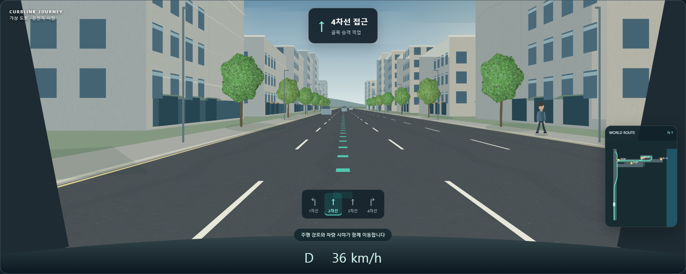
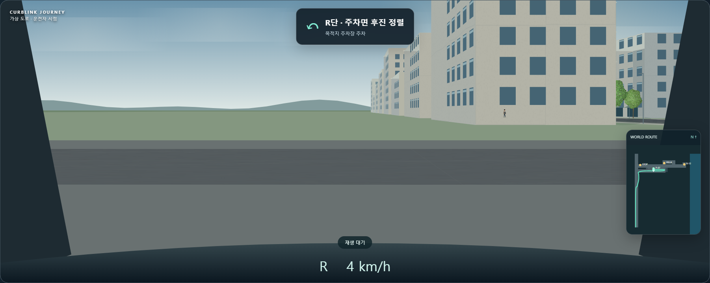
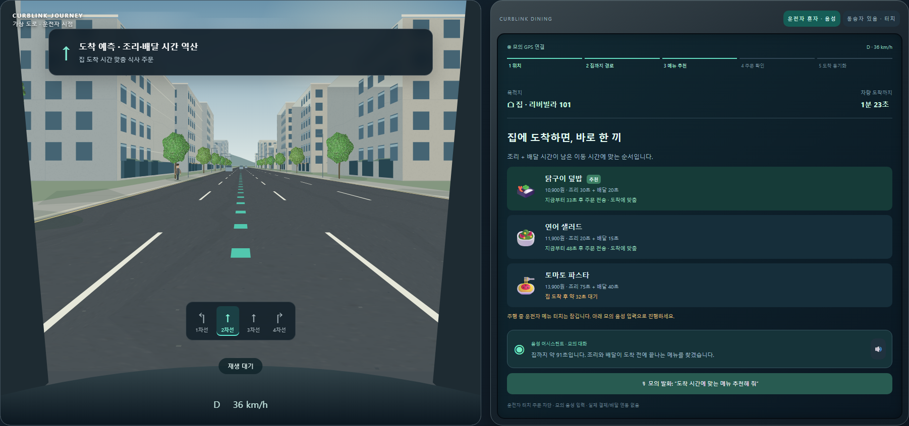

> **simulation — 웹 주행 시뮬레이션 (개발용 검증 환경)** · 공모전 제출 기준은 [`main`](../../tree/main)입니다.

# CurbLink Drive — simulation

> [!IMPORTANT]
> **이 브랜치에서 보여 주는 화면은 CurbLink 앱이 아닙니다.** 앱의 규칙을 실제 도로 없이 시험하려고 팀이 **별도로 만든 웹 시뮬레이션 환경**입니다.
> - 화면 구성과 디자인은 **실제 앱 UI와 다릅니다.** 실제 앱은 [`apk` 브랜치](../../tree/apk)와 [release APK 시연 영상](submission/video/curblink-apk-demo.mp4)을 봐 주세요.
> - 공통점은 **판단 규칙**입니다. 차선 추천, 하차 후보 평가, 식사 시간 맞춤 규칙을 앱과 같은 방식으로 구현해, 앱 결과와 일치하는지 확인합니다.
> - Pleos 플랫폼이나 차량에서 실행되는 화면이 아니며, 앱과 실시간으로 연결되어 있지도 않습니다.

## 무엇을 재현하나

가상 도로·차량 내부·합성 주변 시야를 웹 브라우저에 그려, 실제 도로에서 시험하기 어려운 여섯 가지 여정을 처음부터 끝까지 재현합니다.

| 여정 | 확인하는 것 |
|---|---|
| 1 골목 픽업 | 골목 진입, 승객 탑승, 본선 복귀·합류 |
| 2 주차장 주차 | 진입, 통로 주행, R단 후진, P단 정렬 |
| 3 잠시 정차 | 갓길 정차, 비상등, 본선 재합류 |
| 4 식사 시간 맞춤 | 혼자 운전 시 터치 주문 차단, 명시적 음성 주문, 음식·차량 도착 비교, 수령 |
| 5 한강 음식 인계 | 합성 주변 시야 4방향, 위치 확인, 수령 |
| 6 배리어프리 하차 | 후보 비교, P단 정차 후 공간·장비·직원 확인, 입구 도착 |

**시연 영상:** [curblink-simulation-demo.mp4](submission/video/curblink-simulation-demo.mp4) (3분 48초) · [스크린샷](submission/README.md#웹-주행-시뮬레이션-화면-개발용-검증-환경)

| 골목 픽업 · 본선 복귀 | 주차 · R단 후진 |
|---|---|
|  |  |

| 식사 · 혼자 운전 시 터치 주문 차단 | 배리어프리 · 하차 후보 비교 |
|---|---|
|  |  |

Chrome(Chromium) 헤드리스 소프트웨어 렌더링으로 검증했습니다. 물리 GPU나 실차 성능 검증이 아닙니다. [여정 결과·원본 해시](captures/web/0.5.2/verification.json)

## 실행

```powershell
./scripts/start-experience.ps1 -Mode Simulation -OpenBrowser
```

검증과 녹화:

```powershell
python -m pip install playwright
python -m playwright install chromium     # 또는 녹화 시 --channel chrome 사용
python scripts/verify-simulation.py       # 여섯 여정 자동 실행·캡처
python scripts/record-submission.py --channel chrome   # 시연 영상 녹화
node simulator/js/lane-engine.test.cjs    # 규칙 단위 시험 (simulator/js/*.test.cjs 5개)
```

## 이 브랜치의 이력

| 날짜 | 내용 |
|---|---|
| 10-30 | 웹 도로·차량 내부·주변 시야 시뮬레이션 안내 브랜치로 분리 |
| 10-30 ~ 10-31 | `integration`의 0.5.1·0.5.2 변경을 받아 시뮬레이션 갤러리 갱신 |
| 11-15 | `main`과 같은 소스로 맞추고 README를 개발용 검증 환경 안내로 정리 |

소스는 `main`과 같고 README만 다릅니다. 전체 브랜치 흐름은 [main README의 브랜치 구성과 개발 이력](../../blob/main/README.md#브랜치-구성과-개발-이력)에 있습니다.
