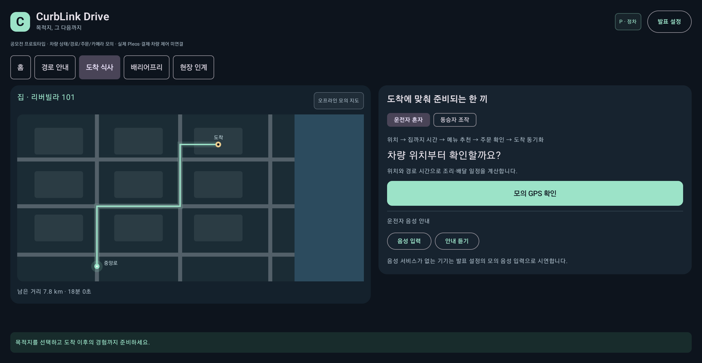
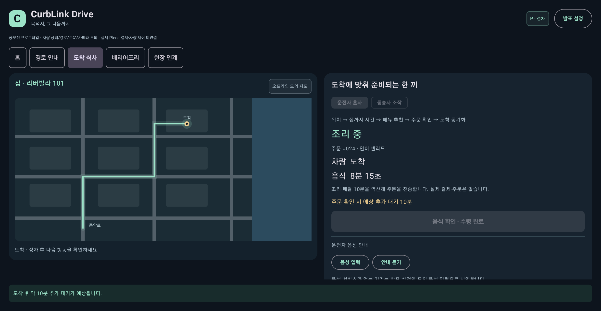
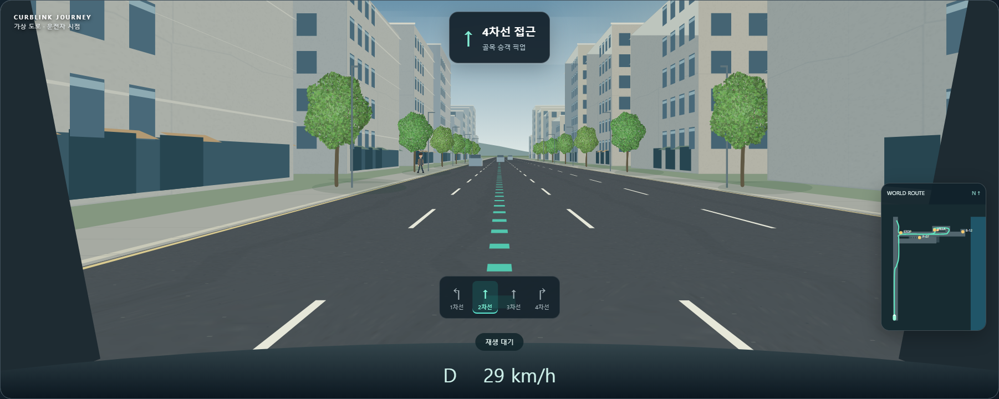

# CurbLink Drive

**목적에 맞는 마지막 500m — 목적지 도착, 식사 시간 맞춤, 배리어프리 하차와 현장 인계를 연결하는 차량용 앱 프로토타입**

현재 버전은 **0.2-contest-demo**입니다. Kotlin / Jetpack Compose 네이티브 Android 앱과 별도 웹 참고 시뮬레이터로 구성됩니다.

[APK 다운로드](release/CurbLink-Drive-0.2-demo.apk) · [설치·시연 안내](release/README.txt) · [개발 인수인계](docs/DEVELOPMENT_HANDOFF.md) · [검증 기록](release/BUILD-VERIFICATION.txt)

## 현재 기능

| 기능 | 구현 내용 |
|---|---|
| 목적지·도착 의도 | 집·문화센터·한강 등 목적지와 픽업 / 잠시 정차 / 주차 / 배리어프리 하차 선택 |
| 경로·차선 안내 | 모의 차량 상태와 도착 목적에 따른 경로·권장 차선 HUD |
| 도착 맞춤 식사 | 위치 탐색 → 목적지 ETA → 조리·배달 시간 기반 메뉴 추천 → 명시적 주문 확인 → 도착 시간 비교 |
| 역할별 조작 | 운전자 음성 중심 / 동승자 디스플레이 조작. 플랫폼 음성과 시연 입력 구분 |
| 배리어프리 하차 | 계단·경사·보행 거리·측면 공간·필요한 지원에 따른 베이 추천, 안전 조건 재확인 후 명시적 승인 |
| 현장 인계 | 모의 주변 상황과 위치 카드로 인계 위치 설명, 사용자 선택으로 공유·수령 확인 |

지도·경로·교통·차량 상태·주문/결제·주변 카메라·도어/리프트는 **모의**입니다. Android 위치와 플랫폼 음성은 기기 권한과 서비스 지원 시 사용합니다. 실제 Pleos SDK·Gleo·CarPay·SVM·차량 제어 연동 완료를 의미하지 않습니다.

## 실제 APK 실행 화면

**0.2 APK 실행 화면 · 2452×1272px · PNG**

상단 상태바·하단 내비게이션 바와 바깥 여백을 제외한 앱 표시 영역입니다. 확대나 리사이즈 없이 잘라냈습니다.

### 목적지 설정

[](captures/android/display/01-home.png)

### 차량 내 식사 주문

[](captures/android/display/02-dining-location.png)

[](captures/android/display/03-dining-menu.png)

[](captures/android/display/04-dining-order.png)

### 배리어프리 하차

[](captures/android/display/05-access-candidates.png)

### 현장 인계

[](captures/android/display/06-handoff.png)

이미지를 클릭하면 전체 해상도로 볼 수 있습니다. [캡처 정보](captures/README.md)

## 웹 참고 시연 화면

아래는 현재 저장소의 **웹 시뮬레이터 참고 캡처**입니다. 네이티브 APK 실행 화면이 아니며 APK와 화면 배치·세부 동작이 다릅니다. 이전 외관/트렁크 인터록 화면은 웹 진입 화면에서 제거했습니다.

### 운전자 시점·차선 안내



가상 도로·건물·수목·보행자 환경에서 목적별 접근 경로를 시연합니다.

### 차량 내부 디스플레이에서 식사 주문


위치 탐색부터 목적지·메뉴 선택, 주문 확인과 도착까지 진행합니다. 운전자·동승자 모드를 구분하며 실제 매장에 주문을 전송하지 않습니다.

### 배리어프리 하차·입구 이동


필요한 공간과 도움에 따라 베이·경로가 달라집니다. 정차·안전 조건 확인과 사용자 승인 후 입구 이동을 시연합니다. 후보 지점과 수치는 가상 데이터입니다.

### 주소 설명이 어려운 현장 인계


한강 등에서 주변 시야와 위치 설명 카드로 인계 지점을 공유합니다. 카메라 화면은 가상 장면이며 실제 서라운드뷰 연동이 아닙니다.

## 실행

### Android APK

Android 10(API 29) 이상, target SDK 35, 패키지 `io.curblink.demo`, 버전 코드 2의 **debug 서명 APK**입니다.

```powershell
adb install -r release/CurbLink-Drive-0.2-demo.apk
adb shell am start -n io.curblink.demo/.MainActivity
```

홈 / 경로 / 도착 식사 / 배리어프리 하차 / 현장 인계 화면에서 시연합니다. 상세 단계는 [배포 안내](release/README.txt)를 확인하세요.

### 웹 참고 시뮬레이터

저장소 루트에서 실행합니다. Android 앱은 이 서버 없이 실행됩니다.

```powershell
python -m http.server 8000
```

<http://127.0.0.1:8000/simulator/> 접속. React·Babel·Tailwind CDN 로딩에 인터넷이 필요합니다.

| 키 / 버튼 | 흐름 |
|---|---|
| 1 골목 픽업 | 우회전 → 골목·건물 앞 탑승 → 회차 → 본선 복귀 |
| 2 주차장 주차 | 목적지 주차장 진입 → 통로 → 후진 주차 |
| 3 잠시 정차 | 도로변 접근 → 비상등 정차 → 재합류 |
| 4 식사 시간 맞춤 | 위치·ETA → 메뉴·주문 → 집 도착·음식 인계 |
| 5 한강 음식 인계 | 현장 도착 → 모의 주변 시야·위치 설명 → 인계 |
| 6 배리어프리 하차 | 지원·베이 비교 → 경로 → 정차·승인 → 입구 이동 |

화면 버튼으로 시나리오와 재생 속도를 선택할 수 있습니다.

## 구조와 빌드

| 구분 | 핵심 파일 |
|---|---|
| 네이티브 화면 | `MainActivity.kt` → `MobilityApp.kt` |
| 네이티브 상태·주행 | `MobilityViewModel.kt` — ViewModel / StateFlow / Coroutines |
| 도메인 규칙 | `MobilityModels.kt` — 목적지·식사·접근성·승인 |
| 웹 시연 제어 | `simulator/index.html`, `simulator/js/destination-demo.jsx` |
| 주행·차선 | `simulator/js/mission-engine.js`, `simulator/js/lane-engine.js` |
| Canvas 2D 렌더링 | `simulator/js/mission-viewport.jsx`, `simulator/js/scenery-assets.js` |
| 식사·접근성 UI | `simulator/js/meal-cabin.jsx`, `simulator/js/access-cabin.jsx` |

Android 소스: `app/src/main/java/io/curblink/demo/`. Kotlin 2.0.21 / Compose / Material 3 / JDK 17 / Gradle 8.9 / AGP 8.7.3 / SDK 35.

JDK 17·SDK 35 설치 후 `JAVA_HOME`, `ANDROID_HOME`을 설정합니다.

```powershell
./scripts/build-drive.ps1
```

APK 빌드·테스트 컴파일·lint·JUnitCore 검증 후 배포 APK와 체크섬을 갱신합니다. Windows 테스트 워커 대응과 다른 PC 설정은 [개발 인수인계](docs/DEVELOPMENT_HANDOFF.md)를 참고하세요.

## 검증 상태

2026-10-29 기존 빌드 기록 기준이며 이번 문서 수정에서 Android 시험을 재실행한 결과는 아닙니다.

- APK 빌드·테스트 컴파일 완료, lint 오류 **0개 / 경고 4개**.
- JUnitCore **40개 통과**: 기존 도메인·세션 29개 + 모빌리티 규칙 11개.
- APK v2 서명 및 16KB 페이지 정렬 검사 통과.
- **Android 실기기에 APK 설치·화면 실행 및 식사 주문 흐름 촬영 완료**. AAOS·Pleos 런타임과 실차 연동은 미검증이며 전체 기능의 종단 시험 완료를 의미하지 않습니다. 로컬 에뮬레이터 부팅 문제는 남아 있습니다.
- 다음 단계: 심사용 기기 UI·음성·전체 흐름 검증, 공식 권한에 따른 Pleos 어댑터, 실제 지도·ETA·주문·카메라 연동.

기존 안전 인터록·브리지 소스와 테스트는 회귀 검증용으로 보존합니다. 이전 v0.1 APK·캡처·문서는 과거 기록이며 최신 앱의 화면이나 검증 결과로 사용하지 않습니다.

## 관련 문서

- [개발 인수인계](docs/DEVELOPMENT_HANDOFF.md)
- [설치·시연·연동 제한](release/README.txt)
- [빌드 검증 기록](release/BUILD-VERIFICATION.txt)
- [캡처 출처·버전 안내](captures/README.md)
- [공모전 공식 공고](https://appdevchallenge.auto-hmg.io/notice/c0a1a000-2026-4923-8000-000000000001)