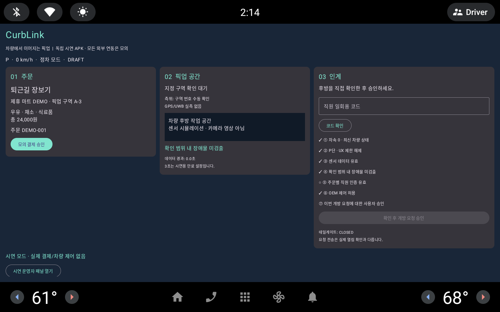
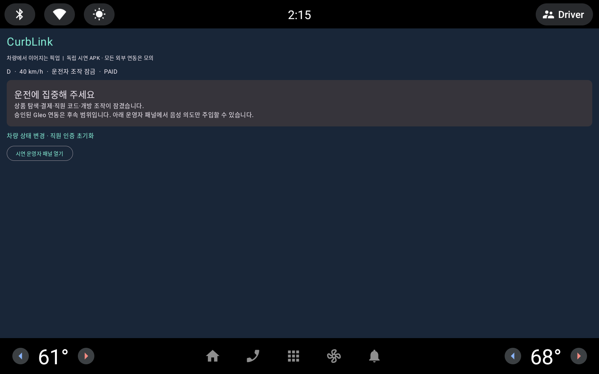
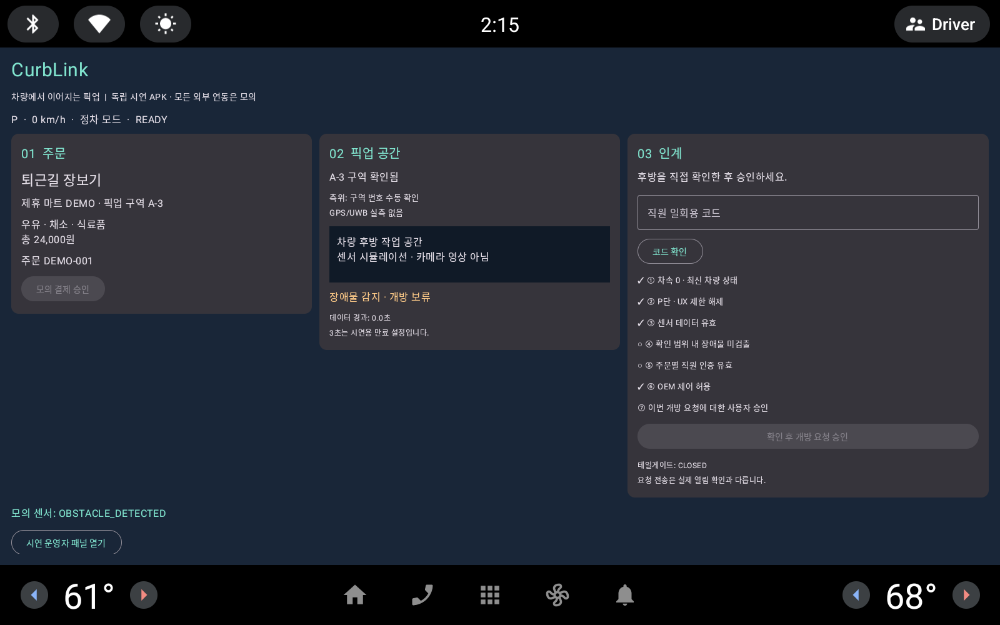
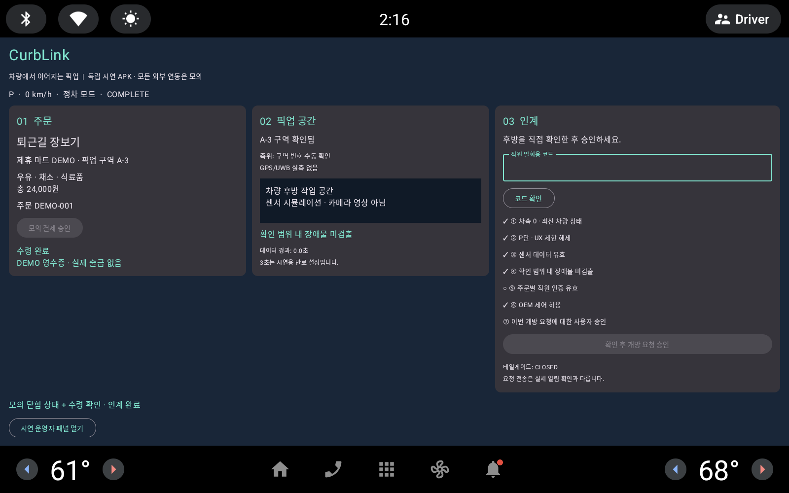
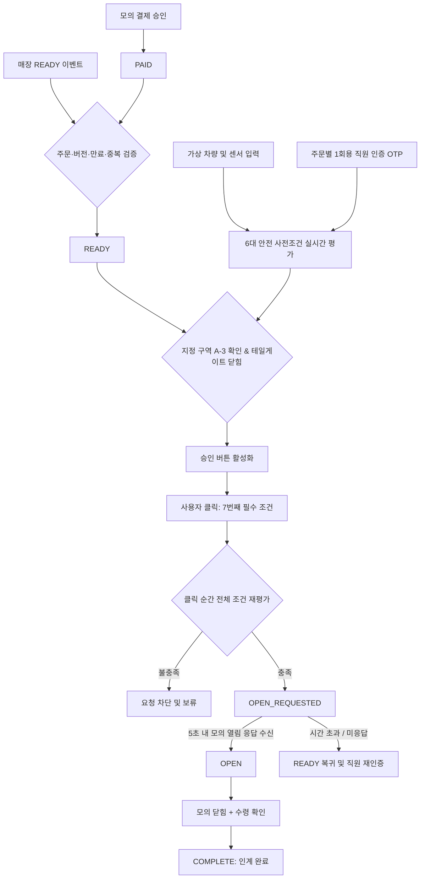

# Pleos CurbLink (플레오스 커브링크)

차량 상태와 센서 인터록 기반의 비하차 신뢰 인계(Trusted Handoff) 커넥티드 서비스  
현대자동차그룹 오픈 앱 개발 공모전(HMG App Dev Challenge) 출품작 · 1인 개발 프로토타입

---

[](https://source.android.com/docs/automotive)
[-blue)](https://developer.android.com/)
[](https://developer.android.com/jetpack/compose)
[](docs/검증결과.txt)
[](release/Pleos-CurbLink-demo.apk)

---

## 1. 프로젝트 개요

Pleos CurbLink는 차량 내 음성 주문 요청과 매장 준비 상태를 차량의 주차(P단)·차속·센서 인터록·사용자 승인 조건과 결합하여, 지정된 픽업 공간(커브사이드)에서 운전자의 하차 없이 테일게이트를 통해 안전하게 물품을 수령하도록 지원하는 Pleos Connect 네이티브 앱 프로토타입입니다.

### 기획 배경 및 문제 정의
- **영유아·고령자 동승 차량의 하차 위험성**: 돌봄 대상자가 동승한 차량의 경우 매장 방문 수령을 위한 짧은 하차도 돌봄의 중단과 안전 공백으로 이어집니다.
- **기존 스마트폰 앱 중심 주문의 한계**: 모바일 기기는 차량의 변속 기어(P/D), 차속, 주변 장애물 감지, 테일게이트 개방 상태를 직접 다루지 못하며 주행 중 운전자 시각 분산을 유발합니다.
- **CurbLink의 접근 방식**: 매장 준비 완료 → 지정 구역 도착 → 6개 안전 인터록 검증 → 사용자 최종 승인 → 인계 완료로 이어지는 상태 머신을 구현하여 안전성과 조작 편의성을 확보합니다.

> **시연 범위 안내**  
> 본 결과물은 독립 실행이 가능한 시연용 데모 앱(v0.1-demo)입니다. 실제 Pleos SDK, Gleo 음성, CarPay, GPS/UWB, SVM 실차 인터페이스는 시연을 위한 모의 입력(Simulated Adapter)으로 구성되어 있으며, 양산 전 OEM 공식 안전 인증 및 실차 시험이 필요한 프로토타입입니다.

---

## 2. 화면 구성 및 실행 흐름

Android Automotive OS (API 33, Google Automotive 시스템 이미지, 1600×1000) 구동 화면

| 01. 정차 중 주문/결제 | 02. 주행 중 조작 잠금 |
|:---:|:---:|
|  |  |
| P단 & 0km/h: 주문 요약, 결제 승인, 안전 사전조건 실시간 표시 | 가상 D단 & 40km/h: 운전자 주의분산 방지를 위한 조작 마스킹 |
| 03. 장애물 감지 시 개방 보류 | 04. 6대 안전조건 충족 및 승인 활성화 |
|  |  |
| 후방 센서 장애물 감지 또는 3초 만료 시 개방 버튼 비활성화 | 전 조건 충족 및 6자리 OTP 인증 완료 시 사용자 승인 버튼 활성화 |
| 05. 테일게이트 개방 및 인계 완료 | 06. 신호 대기 중 조작 잠금 유지 |
|  |  |
| 사용자 명시 승인 → 열림 응답 → 수령 확인 후 인계 완료 | D단 & 0km/h: 차량 정차 상태라도 D단이면 잠금 상태 유지 |

---

## 3. 안전 인터록 및 상태 머신 아키텍처



### 안전 사전조건 (6+1 Prerequisite Logic)
1. **차속 0 및 최신 차량 상태**: 차속 0.0 km/h 및 1초 이내 단조 시계(`SystemClock.elapsedRealtime()`) 갱신 데이터
2. **P단 및 UX 제한 해제**: 변속 기어가 P단에 위치하고 AAOS Car UX Restrictions가 해제된 상태
3. **센서 데이터 유효성**: 최근 3.0초 이내에 수신된 센서 스트림
4. **장애물 미검출**: 확인된 후방 작업 범위 내 장애물 미검출(`CLEAR_IN_VERIFIED_RANGE`)
5. **주문별 직원 인증 유효**: 주문 ID 및 리비전에 귀속된 6자리 일회용 코드 (60초 유효, 5회 실패 시 차단)
6. **OEM 제어 권한 허용**: 차량 제어기 인터록 허용 상태
7. **사용자의 명시적 승인**: 사전 조건 만족 시 승인 버튼이 활성화되며, 클릭 시점에 전 조건을 재평가하여 최종 승인합니다. 원격 자동 개방이나 승인 선저장은 허용되지 않습니다.

---

## 4. 빠른 시작 가이드

### APK 설치 및 시연 순서
1. [release/Pleos-CurbLink-demo.apk](release/Pleos-CurbLink-demo.apk)를 Android 10(API 29) 이상의 기기 또는 에뮬레이터에 설치합니다.
   ```powershell
   adb install -r release/Pleos-CurbLink-demo.apk
   ```
2. 앱 실행 후 `모의 결제 승인`을 클릭합니다 (PAID 상태 전환).
3. 우측 상단 `시연 운영자 패널 열기` → `매장 준비 완료` → `구역 확인 전환`을 차례로 클릭합니다 (A-3 주차 확인).
4. `직원 코드 발급`으로 생성된 6자리 코드를 인계 화면에 입력하고 `코드 확인`을 클릭합니다.
5. 6개 사전 조건 충족 시 `확인 후 개방 요청 승인` 버튼이 활성화됩니다.
6. 버튼 클릭 후 5초 이내에 운영자 패널의 `차량 열림 응답`을 클릭합니다.
7. `닫힘 + 수령 확인`을 누르면 인계 절차가 완료됩니다.

---

## 5. 프로젝트 빌드 및 단위 테스트

### 기술 스택
- **언어 및 런타임**: Kotlin 2.0.21 / JDK 17
- **UI 프레임워크**: Jetpack Compose (BOM 2024.12.01) / Material 3
- **아키텍처**: Android Jetpack ViewModel, Kotlin Coroutines, StateFlow (단방향 UDF)
- **빌드 도구**: Gradle 8.9 / Android Gradle Plugin 8.7.3
- **호환 환경**: compileSdk 35 / minSdk 29 (Android Automotive OS)

### 소스코드 빌드
```powershell
./gradlew.bat assembleDebug
```
빌드 산출물 위치: `app/build/outputs/apk/debug/app-debug.apk`

### 도메인 단위 테스트
Windows 환경에서 실행 가능한 도메인 단위 시험 스크립트를 제공합니다.
```powershell
./run-domain-tests.ps1
```
테스트 범위: 주행 잠금, 신호 대기 잠금, P단 해제, 센서 만료(3초), 장애물 감지 차단, OEM 권한 거부, 중복 결제 멱등성, 원격 개방 이벤트 차단, 승인 전/후 상태 전이 등 17개 전 항목 통과 (상세: [docs/검증결과.txt](docs/검증결과.txt)).

---

## 6. 디렉토리 구조

```text
Pleos-CurbLink/
├── README.md                           # 프로젝트 안내 및 기술 명세서
├── build.gradle.kts                    # 루트 Gradle 빌드 스크립트
├── settings.gradle.kts                 # 모듈 설정 (app)
├── gradle.properties                   # 빌드 파라미터 설정
├── gradlew, gradlew.bat                # Gradle 래퍼
├── run-domain-tests.ps1                # 단위 시험 실행 스크립트
│
├── app/                                # AAOS 데모 애플리케이션 모듈
│   ├── build.gradle.kts
│   └── src/
│       ├── main/
│       │   ├── AndroidManifest.xml     # 앱 매니페스트
│       │   └── java/io/curblink/demo/
│       │       ├── MainActivity.kt               # 진입점 Activity
│       │       ├── CurbLinkMainScreen.kt         # 정차 UI, 주행 락, 운영자 패널
│       │       ├── CurbLinkViewModel.kt          # 상태 머신 및 비즈니스 로직
│       │       ├── CurbLinkModels.kt             # 차량/센서/주문 데이터 모델
│       │       └── SafetyAndPaymentEngines.kt    # 인터록 평가기, 멱등 결제 어댑터
│       └── test/java/io/curblink/demo/
│           └── DomainTest.kt                     # 17개 단위 테스트
│
├── docs/                               # 공모전 제출 기획서 및 심사 자료
│   ├── 02_앱프로젝트소개_1인개발.txt    # 공모전 심사자료 전문 (1인 개발 상세 기획)
│   ├── ARCHITECTURE.md                 # 상태 전이 및 OEM 연동 선행조건 표
│   ├── 검증결과.txt                     # 단위 테스트 및 빌드 검증 보고서
│   └── test-results/
│       └── junit-direct.log            # JUnit 테스트 통과 로그
│
├── captures/                           # AAOS AVD 구동 캡처 이미지
│   ├── 01-parked-order.png
│   ├── 02-driving-lock.png
│   ├── 03-obstacle-hold.png
│   ├── 04-handoff-ready.png
│   ├── 05-handoff-complete.png
│   ├── 06-signal-stop-lock.png
│   └── 캡처설명.txt
│
├── scripts/                            # 개발 및 검증 자동화 도구
│   ├── capture_android.py              # AVD UIAutomator 및 screencap 자동화
│   ├── package_curblink.py             # 패키징 및 SHA256 검증 스크립트
│   ├── ready_capture.py                # 캡처 상태 주입 스크립트
│   └── setup_tools.py                  # 환경 설정 보조 도구
│
└── release/                            # 독립 시연용 릴리즈 바이너리
    ├── Pleos-CurbLink-demo.apk         # 시연용 디버그 APK (v0.1-demo)
    └── SHA256SUMS.txt                  # APK 무결성 해시 (SHA-256)
```

---

## 7. OEM 양산 연동 로드맵

| 연동 시스템 | 선행 필요 조건 | 검증 항목 및 완료 증거 |
|:---|:---|:---|
| **Pleos Vehicle SDK** | 차종별 읽기/제어 권한 및 공식 SDK | Pleos 전용 AVD 및 허용 차량 신호 로그 |
| **Gleo AI 음성** | NLU Intent 등록 및 주행 중 음성 정책 승인 | 실제 발화 → Intent 바인딩 → 청취 확인 흐름 |
| **Hyundai CarPay** | 공식 가맹 제휴, 테스트 계정, 서명 콜백 | 샌드박스 거래, 이중 청구 방지, 취소/환불 검증 |
| **SVM / 초음파 센서** | 센서 데이터 스트림 API 권한 및 보안 검증 | 렌즈 오염, 역광, 센서 통신 단절 Fail-Safe 시험 |
| **파워 테일게이트** | OEM 안전 인터록 및 끼임 방지 우회 불가 검증 | OEM 엔지니어 입회하 비상 정지/반전 실차 시험 |
| **UWB 측위** | 정밀 측위 앵커 및 차량 트랜시버 접근 권한 | 지정 주차 구역(A-3) 측위 오차 반경 0.5m 이내 검증 |

---

## 8. 참고 자료
- [현대자동차그룹 오픈 앱 개발 공모전](https://appdevchallenge.auto-hmg.io/notice/c0a1a000-2026-4923-8000-000000000001)
- [Pleos Connect SDK Reference](https://document.pleos.ai/en/api-reference/connect-sdk-pleos/)
- [Android Automotive OS Driver Distraction Guidelines](https://source.android.com/docs/automotive/driver_distraction/guidelines)
- [NHTSA Visual-Manual Driver Distraction Guidelines](https://www.transportation.gov/regulations/federal-register-documents/2013-09883)
- [현대 카페이(Hyundai CarPay) 서비스 안내](https://www.hyundai.com/kr/ko/digital-customer-support/app/hyundai-car-pay/hyundai-car-pay-information)
