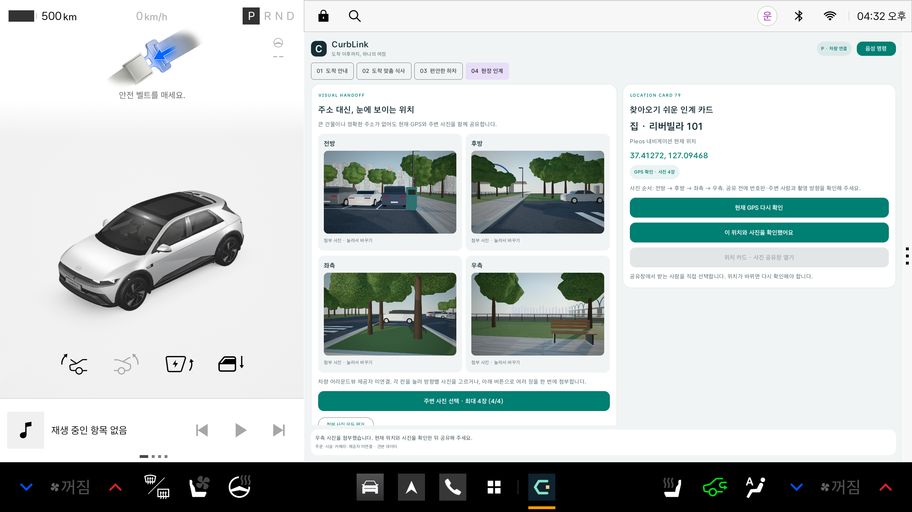

> **apk — 차량 앱 설치·실행 안내** · 공모전 제출 기준은 [`main`](https://github.com/leechanghwanspace/Pleos-CurbLink/tree/main)입니다.

# CurbLink Drive — apk

주행 중 차량 상태를 읽어, 도착 이후의 식사·편안한 하차·현장 인계를 안전하게 미리 준비하는 Pleos 차량용 앱입니다. 이 브랜치는 **앱 설치와 실행**에 필요한 내용만 모았습니다.

## 다운로드

| 파일 | 설명 |
|---|---|
| [`apk/이창환_CurbLink_release.apk`](apk/이창환_CurbLink_release.apk) · [SHA-256](apk/이창환_CurbLink_release.apk.sha256) | **제출용 release 빌드** (현재 로컬 debug 키 서명). 시뮬레이션·시험 코드 미포함, v2 서명, 16KB 정렬 통과 |
| [release APK 시연 영상](submission/video/curblink-apk-demo.mp4) (2분 49초, 2560×1440) | Pleos Connect v2.1.0 에뮬레이터, 실제 차량 연결(P단)에서 식사 예약 → 하차 대안 → 안전 확인 → 방향별 주변 이미지 첨부 → 위치 카드 |
| [스크린샷](submission/README.md#release-apk-화면-pleos-connect-v210-25601440) | release APK 화면 9장. 현장 인계의 주변 이미지는 [3D로 렌더링한 예시](submission/example-photos/README.md)이며 실제 사진이 아님 |

## 테스트 환경

| 항목 | 값 |
|---|---|
| 에뮬레이터 | **Pleos Connect v2.1.0** (Android 14 / API 34, android-automotive, x86_64) |
| 화면 규격 | **2560×1440, 160dpi** |
| Pleos SDK | `ai.pleos.playground:NaviHelper:3.0.5`, AAOS CarService(기어·속도·UX 제한) |
| 앱 요구 사항 | minSdk 29 / targetSdk 35, `android.hardware.type.automotive` 필수 |

## 설치와 실행

```powershell
adb install -r apk/이창환_CurbLink_release.apk
```

앱 목록에서 **CurbLink Drive**를 실행합니다. 이미 다른 서명으로 설치되어 있으면 앱 데이터를 지우기 전에 인증서를 먼저 확인하세요.

**필요한 설정**
- 위치 권한 (없으면 위치 확인과 식사 추천 보류)
- 차량 속도·파워트레인 권한 `CAR_SPEED`, `CAR_POWERTRAIN` (없으면 조작 제한)
- 내비게이션 경로 권한 `pleos.car.permission.NAVI_ROUTE`과 Pleos 내비게이션 이용 동의
- 조작은 **P단 정차** 상태에서만 열립니다. 주행 중에는 음성 명령만 받습니다.

## 앱 화면

| 도착 시간 맞춤 메뉴 추천 | A-2 이용 불가 → A-3 대안 |
|---|---|
|  |  |

| 안전 확인 · 입구 도착 | 방향별 주변 이미지 첨부 (3D 렌더링 예시) |
|---|---|
|  |  |

CarService·NaviHelper는 에뮬레이터의 실제 서비스에 연결합니다. 차선·신호, 매장·주문, 하차 시설, 주변 카메라는 견본 데이터 또는 시험 입력입니다.

## 직접 빌드

```powershell
. ./scripts/use-home-env.ps1
./gradlew.bat :app:assembleRelease
# 제품 APK 경계 확인 (시뮬레이션·시험 코드 미포함)
./scripts/check-vehicle-apk.ps1 -Apk app/build/outputs/apk/release/app-release.apk
```

저장소 루트에 `keystore.properties`가 있으면 그 키로 서명하고, 없으면 로컬 debug 키로 서명합니다.

## 이 브랜치의 이력

| 날짜 | 내용 |
|---|---|
| 10-30 | 네이티브 차량 앱 설치·실행 안내 브랜치로 분리 |
| 10-30 ~ 10-31 | `integration`의 0.5.1·0.5.2 변경을 받아 APK 링크·캡처 갱신 |
| 11-15 | `main`과 같은 소스로 맞추고 제출용 release APK 기준으로 README 정리 |

소스는 `main`과 같고 README만 다릅니다. 이전 버전 APK(0.2~0.5.2 프리뷰)는 [`release/`](release/)에 보존합니다. 전체 브랜치 흐름은 [main README의 브랜치 구성과 개발 이력](https://github.com/leechanghwanspace/Pleos-CurbLink/blob/main/README.md#브랜치-구성과-개발-이력)에 있습니다.
