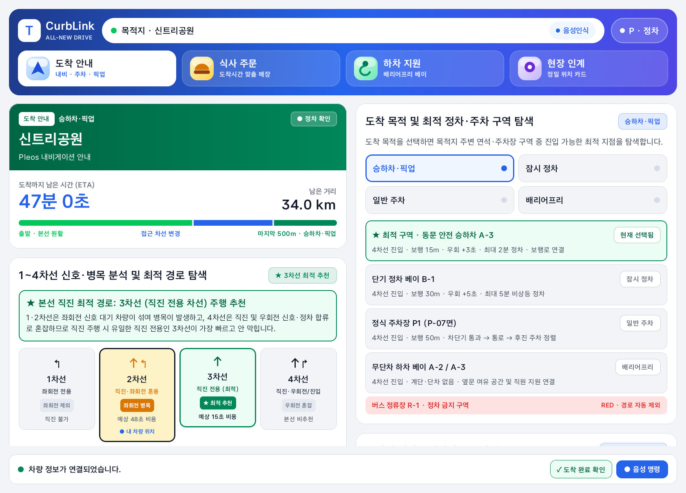
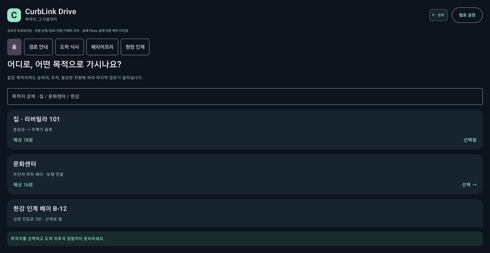
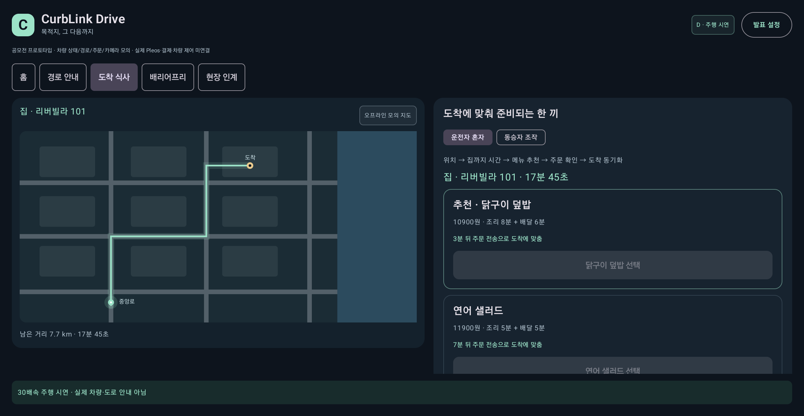
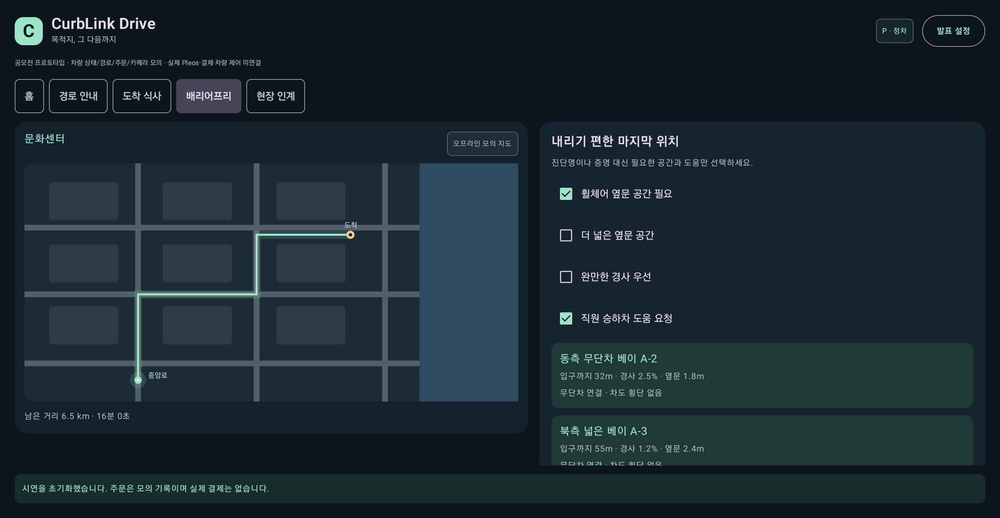
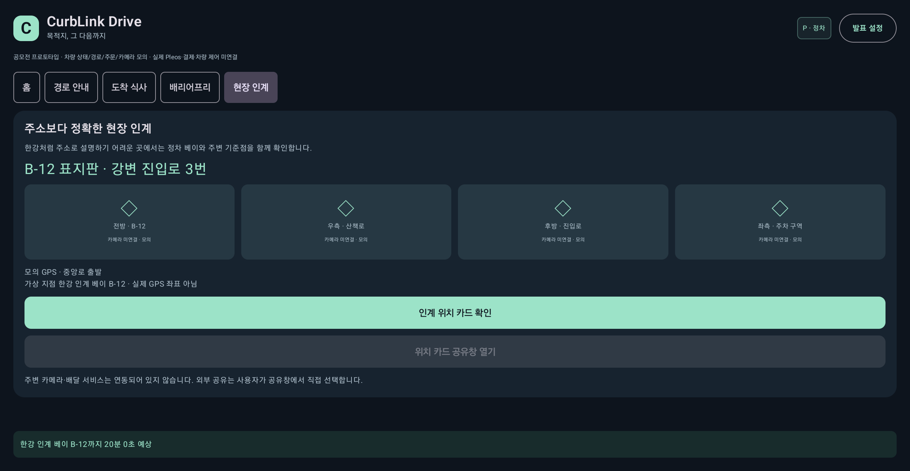
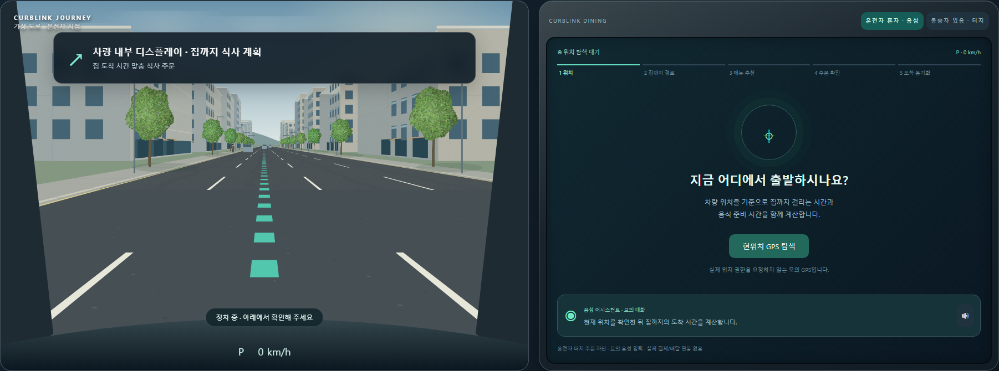
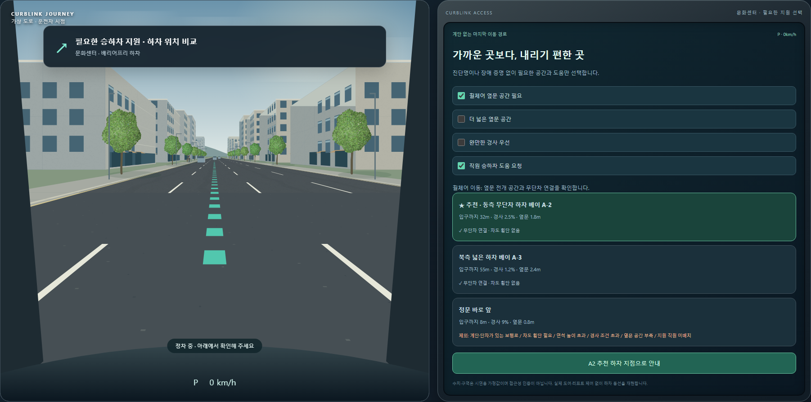
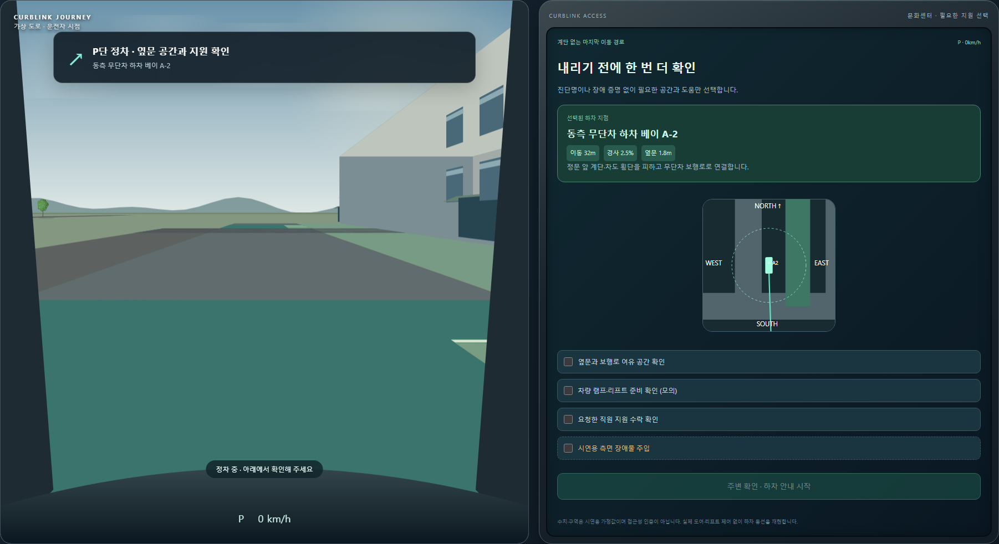
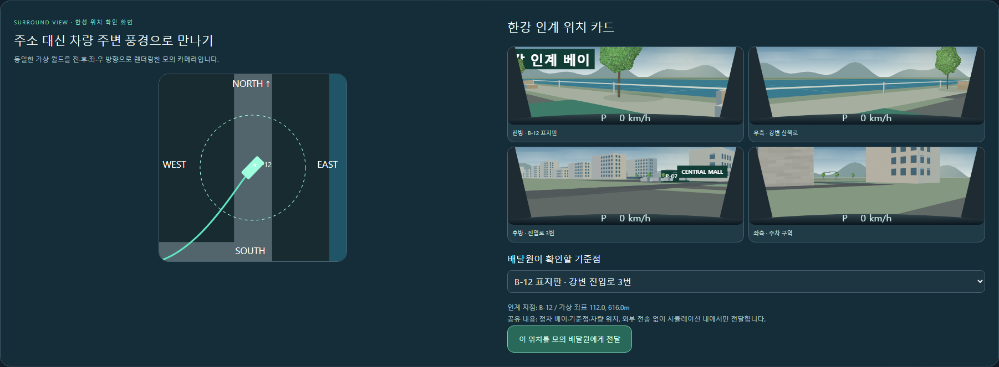

> **현재 작업 브랜치: `integration` — 시뮬레이션 + APK 통합 개발·검증**
>
> [최종 main](https://github.com/leechanghwanspace/Pleos-CurbLink/tree/main) · [웹 시뮬레이션](https://github.com/leechanghwanspace/Pleos-CurbLink/tree/simulation) · [통합 개발](https://github.com/leechanghwanspace/Pleos-CurbLink/tree/integration) · [APK 단독](https://github.com/leechanghwanspace/Pleos-CurbLink/tree/apk)
>
> **[어떤 브랜치를 열어야 하나요? → 브랜치 안내](docs/BRANCH_GUIDE.md)**
> 공통 변경의 합류점은 `integration`입니다. `main`은 대상 기기 검증 후 최종본으로 승격합니다. 현재 0.5는 빌드·규칙 시험을 통과한 개발본이며, 실제 Pleos 실행 검증은 남아 있습니다.

# CurbLink Drive

**목적에 맞는 마지막 500m — 목적지 도착, 1~4차선 최적 경로 탐색, 식사 시간 맞춤 주문, 배리어프리 하차와 현장 인계를 연결하는 차량용 모빌리티 플랫폼**

현재 개발 브랜치는 **`integration`**입니다. `origin/codex/simulation-app-redesign`의 **0.4 UI**를 기준으로 **0.5-arrival-studio / versionCode 6**으로 개선했습니다. `main`과 기존 배포물은 보존했습니다.

## 0.5 디자인·기능 업데이트 — 2026-10-30

- **[통합 목업 파일](release/CurbLink-Drive-0.5-mockup.html)**: 브라우저에서 여는 단일 HTML. 인터랙티브 4개 화면, 웹 목업 캡처 4장, 웹 목업 시연 영상, APK 다운로드를 포함합니다. **새 APK 실행 캡처·Pleos 영상이 아닙니다.**
- **[설치용 APK](release/CurbLink-Drive-0.5-arrival-studio.apk)**: Compose 네이티브 UI, Android 10 이상 / 자동차 기능 required / debug 서명.
- [가벼운 개발용 목업](release/studio/index.html) · [작업 결과·남은 연동](docs/CONTEST_0_5_HANDOFF.md) · [검증 기록](release/VERIFICATION-0.5.json)

앱 내 목적지 선택 유지, 신호·대기열·분기점 조기 준비 규칙, GPS 실패 시 고정 좌표 제거, 음성 응답 읽기, 시간 맞춤 메뉴, 경사·단차·문 개방 공간 비교, 위치 카드와 실제 이미지 첨부 공유를 반영했습니다.

**현재 목적지는 견본 3곳입니다. 실제 POI 검색·경로 생성·차선/신호/정체 제공자, 배달 주문·시설·어라운드뷰 SDK는 연결되지 않았습니다.** 다른 내비 목적지의 ETA를 앱 목적지에 붙이지 않습니다. 일치하는 경로 관측이 없으면 경로 연결 대기, 차선 입력이 없으면 추천 대기로 표시합니다. 동승자 모드 선택만으로 차량 UX 제한을 해제하지 않습니다.

이번 PC에서는 APK/시험 APK 빌드·JVM 규칙·lint·웹 목업 검증까지만 진행합니다. **0.5 실제 APK 캡처·Pleos 시연 영상·공식 폼팩터·음성·실카메라 검증은 집 PC에서 수행할 항목**입니다. 아래 0.4 및 0.2 실제 캡처·연동 기록은 이전 버전의 증거입니다.


> **코덱스(Codex) / 안티그래피(Antigravity) 이어하기 안내**
> - **다음 단계 핵심 작업 명세서**: **[`docs/SIMULATION_APP_PARITY_PLAN.md`](docs/SIMULATION_APP_PARITY_PLAN.md)** (시뮬레이션 개편 및 앱 내 정적 1~4차선 목업을 실제 시뮬레이션 기반 동적 경로 탐색으로 전환하기 위한 전체 가이드)
> - **플랫폼 연동 및 최신 인수인계**: **[`docs/ANTIGRAVITY_HANDOFF.md`](docs/ANTIGRAVITY_HANDOFF.md)** · **[`docs/DEVELOPMENT_HANDOFF.md`](docs/DEVELOPMENT_HANDOFF.md)** · **[`docs/HOME_PC_PROGRESS.md`](docs/HOME_PC_PROGRESS.md)**
> - **원클릭 에뮬레이터 실행**: 저장소 루트의 **[`run-pleos-app.cmd`](run-pleos-app.cmd)** 실행 (또는 `powershell -ExecutionPolicy Bypass -File scripts/launch-pleos-ui.ps1`)

기존 배포 기준선인 **0.2-contest-demo** 및 **0.3-vehicle-app-preview** APK·캡처는 그대로 보존했습니다. Kotlin / Jetpack Compose 네이티브 Android 차량용 앱(`app/src/main`)과 웹 시뮬레이터(`simulator/`), 네이티브 시뮬레이션 레퍼런스(`simulator/native-reference/`, `app/src/testSupport/`)로 구성됩니다.

[차량 앱 0.4 APK](release/CurbLink-Drive-0.4-pleos-connected-preview.apk) · [0.4 실행·한계](release/NATIVE-PREVIEW.md) · [0.2 APK 다운로드](release/CurbLink-Drive-0.2-demo.apk) · [검증 기록](release/BUILD-VERIFICATION.txt)

## 이전 0.4 기준 기능 및 개편 계획 (`codex/simulation-app-redesign`)

| 영역 | 현재 구현 내용 (`0.4-pleos-connected-preview`) | 다음 단계 개편 과제 ([`SIMULATION_APP_PARITY_PLAN.md`](docs/SIMULATION_APP_PARITY_PLAN.md)) |
|---|---|---|
| 차량·내비게이션 연동 | AAOS `CarPropertyManager` 기어·차속, `CarUxRestrictionsManager` 주행 제한, Pleos `NaviHelper:3.0.5` 현재 목적지·남은 시간·거리·위치 실시간 수신 (`PlatformConnections.kt`, 정차 중 목적지 깜빡임 버그 수정 완료) | 실제 내비게이션 경로와 시뮬레이션 경로/차선 상태의 유기적 결합 |
| 1~4차선 경로·차선 탐색 | 1·2차선 좌회전 병목, 4차선 직진+우회전 신호·정차 진입, **3차선 직진 전용 최적 추천** 및 목적지 접근 시 **3→4차선 순차 진입** 비용 모델(`LaneRecommendation.kt`) 및 150% 확대 대시보드 UI | 현재 앱에 정적 목업 카드 형태로 들어간 1~4차선 UI를 개편된 시뮬레이션 엔진과 실시간 연동하여 동적 경로 탐색으로 전환 |
| 목적지 연석·주차 구역 탐색 | 도착 목적(`승하차·픽업`, `잠시 정차`, `일반 주차`, `배리어프리`)에 따른 최적 구역(`A-3`, `B-1`, `P1`, `A-2/A-3`) 탐색 및 정차 금지 구역(`R-1`) 자동 제외 | 시뮬레이션 도로/연석 노드와의 실시간 위치·진입 차선 동기화 |
| 도착 맞춤 식사 주문 | 목적지 인근 5개 배달·픽업 가맹점 목업(`온기키친`, `그린보울`, `브루클린 버거웍스`, `블루보틀`, `트라토리아`) · `조리시간 + 배달시간 <= 도착 예정 시간(ETA)` 기준 추천·정렬 · 4단계 주문 트래킹(`접수→조리→배달→도착`) | 웹 시뮬레이터(`meal-planner.js`)와 앱의 가맹점/주문 타이밍 모델 통합 |
| 배리어프리 하차 지원 | 필요한 공간·지원 선호(휠체어 옆문 공간, 완만한 경사, 직원 지원)에 따른 후보 베이(`A-3`, `A-2`, `정문 앞`) 비교 · 지점 선택 즉시 우측 상단 `하차 전 안전 확인` 체크리스트 전환 · 측면 장애물 감지 시 즉시 보류 및 재승인 | 시뮬레이션의 무단차 보행 동선 및 하차 인터록 시각화 연동 |
| 현장 인계 | 차량 전·후·좌·우 4방향 현장 기준점(`B-12 표지판`, `강변 산책로`, `진입로 3번`) 확인 및 위치 버전 검증 후 외부 공유 | 서라운드 시야 및 배달원 접근 시뮬레이션 연동 |

**차량 상태(`android.car`)와 Pleos 내비게이션(`NaviHelper:3.0.5`)은 Pleos Connect 2.1.0 에뮬레이터에서 실제 서비스 IPC 연결을 검증했습니다.** Android 위치와 플랫폼 음성은 기기 권한과 서비스 지원 시 사용합니다. 반면 **주문·결제·시설 정보·주변 카메라·도어/리프트 제어는 미연결**이며 기본 화면에 `주문·시설 서비스: 확인 대기`로 구분 표시합니다. 실차 주행 검증이나 상용 주문/결제 제공자 연동 완료를 의미하지 않습니다.

## 실제 APK 실행 화면

### 차량 앱 프리뷰 (0.4) — 시뮬레이션 분리 및 Pleos 실제 연결

아래는 Pleos Connect 2.1.0 에뮬레이터의 앱 창 PixelCopy 원본(1682×1210px)입니다. 가상 주행·카메라 장면 없이 차량 기능 화면만 표시합니다.



[연결 대기 화면](captures/android/vehicle-app-preview/01-connection-wait.png) · [식사(외부 검증 입력)](captures/android/vehicle-app-preview/02-dining.png) · [하차 지원(외부 검증 입력)](captures/android/vehicle-app-preview/03-access.png) · [현장 인계(외부 검증 입력)](captures/android/vehicle-app-preview/04-handoff.png) · [검증 출처 및 SHA-256](captures/android/vehicle-app-preview/verification.json)

### 기존 0.2 배포 화면

**0.2 APK 실행 화면 · 2452×1272px · PNG**

상단 상태바·하단 내비게이션 바와 바깥 여백을 제외한 앱 표시 영역입니다. 확대나 리사이즈 없이 잘라냈습니다.

### 목적지 설정

[](captures/android/display/01-home.png)

### 차량 내 식사 주문

[](captures/android/display/02-dining-location.png)

[](captures/android/display/03-dining-menu.png)

[](captures/android/display/04-dining-order.png)

### 배리어프리 하차

[](captures/android/display/05-access-candidates.png)

### 현장 인계

[](captures/android/display/06-handoff.png)

이미지를 클릭하면 전체 해상도로 볼 수 있습니다. [캡처 정보](captures/README.md)

## 웹 참고 시연 화면

아래는 현재 저장소의 **웹 시뮬레이터 참고 캡처**입니다. 네이티브 APK 실행 화면이 아니며 APK와 화면 배치·세부 동작이 다릅니다. 이전 외관/트렁크 인터록 화면은 웹 진입 화면에서 제거했습니다.

### 운전자 시점·차선 안내


가상 도로·건물·수목·보행자 환경에서 목적별 접근 경로를 시연합니다.

### 차량 내부 디스플레이에서 식사 주문




위치 탐색부터 목적지·메뉴 선택, 주문 확인과 도착까지 진행합니다. 운전자·동승자 모드를 구분하며 실제 매장에 주문을 전송하지 않습니다.

### 배리어프리 하차·입구 이동





필요한 공간과 도움에 따라 베이·경로가 달라집니다. 정차·안전 조건 확인과 사용자 승인 후 입구 이동을 시연합니다. 후보 지점과 수치는 가상 데이터입니다.

### 주소 설명이 어려운 현장 인계



한강 등에서 주변 시야와 위치 설명 카드로 인계 지점을 공유합니다. 카메라 화면은 가상 장면이며 실제 서라운드뷰 연동이 아닙니다.

## 실행

### Android APK (Pleos Connect 2.1.0)

Android 10(API 29) 이상, target SDK 35, 패키지 `io.curblink.demo`, 버전 코드 5 (`0.4-pleos-connected-preview`)의 **debug 서명 APK**입니다.

```powershell
adb -s emulator-5554 install -r -g release/CurbLink-Drive-0.4-pleos-connected-preview.apk
adb -s emulator-5554 shell am start --user 10 -n io.curblink.demo/.MainActivity
```

도착 / 식사 / 하차 지원 / 현장 인계 화면에서 실행합니다. 상세 단계는 [0.4 프리뷰 안내](release/NATIVE-PREVIEW.md) 및 [기존 0.2 안내](release/README.txt)를 확인하세요.

### 웹 참고 시뮬레이터

저장소 루트에서 실행합니다. Android 앱은 이 서버 없이 실행됩니다.

```powershell
python -m http.server 8000
```

<http://127.0.0.1:8000/simulator/> 접속. React·Babel·Tailwind CDN 로딩에 인터넷이 필요합니다.

| 키 / 버튼 | 흐름 |
|---|---|
| 1 골목 픽업 | 우회전 → 골목·건물 앞 탑승 → 회차 → 본선 복귀 |
| 2 주차장 주차 | 목적지 주차장 진입 → 통로 → 후진 주차 |
| 3 잠시 정차 | 도로변 접근 → 비상등 정차 → 재합류 |
| 4 식사 시간 맞춤 | 위치·ETA → 메뉴·주문 → 집 도착·음식 인계 |
| 5 한강 음식 인계 | 현장 도착 → 모의 주변 시야·위치 설명 → 인계 |
| 6 배리어프리 하차 | 지원·베이 비교 → 경로 → 정차·승인 → 입구 이동 |

화면 버튼으로 시나리오와 재생 속도를 선택할 수 있습니다.

## 구조와 빌드

| 구분 | 핵심 파일 |
|---|---|
| 네이티브 화면 | `MainActivity.kt` → `MobilityApp.kt` |
| 플랫폼 서비스 연결 | `PlatformConnections.kt` — AAOS `CarService` 및 Pleos `NaviHelper` 어댑터 |
| 네이티브 상태·전이·저장 | `MobilityViewModel.kt`, `JourneyTransitions.kt`, `JourneyStore.kt`, `LaneRecommendation.kt` |
| 도메인 규칙 | `MobilityModels.kt` — 목적지·식사·접근성·승인 |
| 외부 시험 드라이버 | `app/src/testSupport/`, `app/src/androidTest/` — 제품 APK에 미포함 |
| 웹 시연 제어 | `simulator/index.html`, `simulator/js/destination-demo.jsx` |

Android 소스: `app/src/main/java/io/curblink/demo/`. Kotlin 2.0.21 / Compose / Material 3 / JDK 17 / Gradle 8.9 / AGP 8.7.3 / SDK 35.

JDK 17·SDK 35 설치 후 `JAVA_HOME`, `ANDROID_HOME`을 설정합니다.

```powershell
./scripts/build-drive.ps1
```

APK 빌드·테스트 컴파일·lint·JUnitCore 검증 후 배포 APK와 체크섬을 갱신합니다.

## 검증 상태 (`0.4-pleos-connected-preview`)

2026-10-29 Pleos Connect 2.1.0 (API 34) 에뮬레이터 및 호스트 검증 기준입니다.

- APK 빌드·테스트 컴파일 완료, lint 오류 **0개 / 기존 의존성 경고 3개**.
- JUnitCore **65개 통과**: 도메인·모빌리티·여정 전이·차선 추천·차량 문맥·외부 엔진 회귀 시험.
- 제품 APK 경계 검사(`scripts/check-vehicle-apk.ps1`) **PASS**: 자동차 기능 required, 시뮬레이션 엔진·렌더러·시나리오·발표 클래스 미포함 확인.
- APK v2 서명 및 zipalign 정렬 검사 통과.
- **Pleos Connect 2.1.0 실제 플랫폼 연결 Instrumentation 통과**: `CarService` 기어 P·UX 제한 수신, `NaviHelper` 목적지(`신트리공원`)·남은 시간·거리 수신, 권한 미확인 시 제한, 생명주기 stop/reconnect 검증 (6개 조건).
- **외부 시험 드라이버 18개 흐름(6종×3회, 86개 조건) 및 프로세스 재시작 후 주문 ID 복구 통과**.

기존 안전 인터록·브리지 소스와 테스트는 회귀 검증용으로 보존합니다.

## 관련 문서

- [안티그래피 인수인계](docs/ANTIGRAVITY_HANDOFF.md)
- [집 PC 검증 기록](docs/HOME_PC_PROGRESS.md)
- [개발 인수인계](docs/DEVELOPMENT_HANDOFF.md)
- [0.4 프리뷰 안내](release/NATIVE-PREVIEW.md)
- [캡처 출처·버전 안내](captures/README.md)
- [공모전 공식 공고](https://appdevchallenge.auto-hmg.io/notice/c0a1a000-2026-4923-8000-000000000001)
