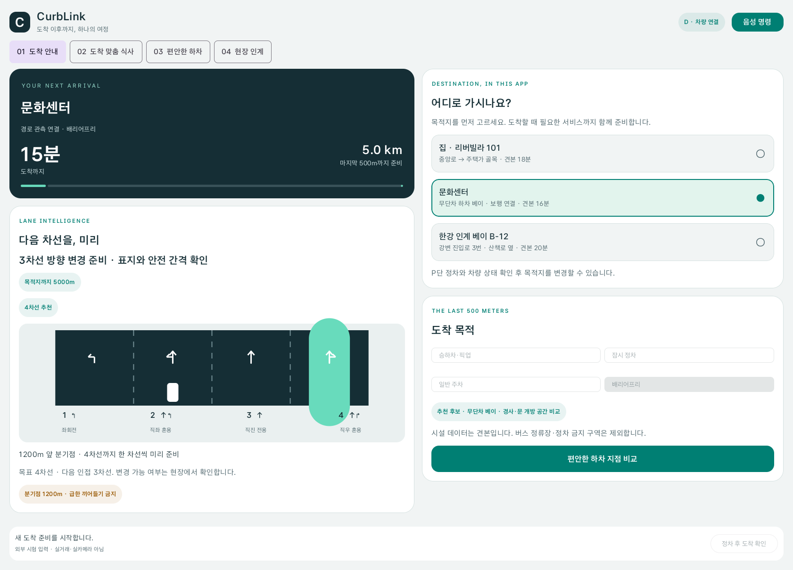
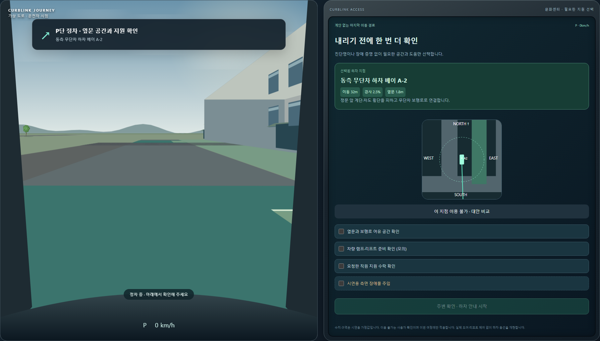

# 캡처 출처와 촬영 규격

## 최신 0.5.2 — 현재 README에서 사용하는 화면

- [실제 차량 앱 캡처·파일별 해시](android/0.5.2/verification.json): Pleos Connect 2.1.0에서 0.5.2-arrival-preview/versionCode8 실행. 앱 창 PixelCopy 원본 1682×1210 PNG이며 크롭·합성·리사이즈 없음.
- 01은 실제 CarService/NaviHelper 서비스 연결, 02~06은 실제 차량 연결 아래 견본 매장·하차·인계 UI, 07~09는 별도 시험 APK의 TEST 관측을 통한 차선 준비·대안·후보 없음 검증이다. 실제 주문·시설·차선 제공자 연결 증거와 구분한다.
- [웹 도로 시뮬레이션 캡처·해시](web/0.5.2/verification.json): `simulator/` 여섯 여정 완료, 1920×1200 뷰포트/배율1의 요소 영역 원본 PNG 9장. 소프트웨어 렌더링이며 APK/물리 GPU/실차 검증이 아니다.
- 재현: `python scripts/verify-simulation.py`, 복구 화면은 `python scripts/verify-ux-simulator.py`. Playwright/Chromium 필요.
- [최신 전체 갤러리](../README.md). 아래 이전 버전 자료는 이력으로 보존하며 현재 화면 증거로 사용하지 않는다.

## 차량 앱 프리뷰 — android/vehicle-app-preview/

사용자 확정 방향에 따라 시뮬레이션을 분리한 `0.4-pleos-connected-preview` (versionCode 5)의 실제 Pleos 2.1.0 앱 창 캡처다. Android PixelCopy로 앱 창만 1682×1210px PNG 원본으로 수집했으며 크롭·합성·리사이즈를 하지 않았다. 전체 디스플레이의 Pleos 차량 홈 패널은 앱 창에 포함하지 않는다.

- `01-pleos-connected.png`: Pleos Connect 2.1.0 에뮬레이터에서 실제 AAOS `CarService`(기어 P · 정차, UX 제한)와 `NaviHelper`(목적지 `신트리공원`, 남은 시간 51분 0초, 남은 거리 30.0km)가 IPC로 연결된 화면. 주문·시설 서비스는 미연결(`확인 대기`)로 구분 표시된다.
- `01-connection-wait.png`: 차량 및 내비게이션 서비스 연결 전/단절 시 조작을 제한하는 기본 화면.
- `02-dining.png` ~ `04-handoff.png`: 별도 시험 APK(`VehicleAppInstrumentation`)가 외부에서 검증용 입력을 공급한 식사·하차·인계 화면이다. 제품 APK에 가상 장면·시나리오·발표 조작은 없다. 캡처의 개발 검증용 표시를 실제 주문/시설 서비스 연동 증거로 해석하지 않는다.
- APK/PNG 해시와 시험 출처는 해당 폴더의 `verification.json`에 있다. 공식 제출 이미지 규격·폼팩터 검증을 대체하지 않는다.

## 실제 Android APK — android/

배포 APK `release/CurbLink-Drive-0.2-demo.apk`의 실행 캡처입니다.

README는 `android/display/`의 **2452×1272px** PNG를 사용합니다. 2560×1380px 원본에서 상단 상태바·하단 내비게이션 바와 바깥 여백만 제거했습니다. 크롭 좌표는 `(108, 36, 2560, 1308)`이며 리사이즈·합성은 하지 않았습니다. `python scripts/crop-drive-captures.py`로 재현합니다.

아래는 보관용 원본(`android/`)의 촬영 정보입니다. README용 크롭은 공식 제출 이미지 크기와 다릅니다. 실제 AAOS/Pleos/차량 디스플레이 촬영 자료는 아닙니다.

- Pleos 공식 이미지 규격 중 **2560×1380px**를 적용했습니다. 이미지당 8MB 이하 PNG입니다.
- 기기 논리 디스플레이를 가로 2560×1380px / 240dpi로 설정해 앱이 해당 크기로 직접 렌더링하도록 했습니다.
- `adb exec-out screencap -p` 결과를 그대로 저장했습니다. 리사이즈·선명화·합성·JPEG 변환을 하지 않았으며 Android 시스템 바를 포함합니다.
- 개별 JSON에는 기기 모델, Android 버전, APK SHA256, PNG SHA256과 촬영 시각을 기록합니다. 기기 시리얼과 개인 GPS는 게시하지 않습니다.
- 촬영 후 원래 해상도·밀도·회전 설정을 복원합니다. 앱 APK와 모의 시연 데이터는 기기에 남습니다.

| 파일 | 실제 실행 화면 |
|---|---|
| 01-home.png | 목적지 선택 홈 |
| 02-dining-location.png | 식사 주문 위치 확인 단계 |
| 03-dining-menu.png | ETA·조리·배달 소요 시간 비교와 메뉴 추천 |
| 04-dining-order.png | 모의 주문 후 추적. 늦게 주문한 경우 추가 대기 표시 포함 |
| 05-access-candidates.png | 지원 조건·하차 후보 비교. 아래 후보는 스크롤로 확인 |
| 06-handoff.png | 모의 주변 상황과 위치 카드. 실제 카메라 미연결 |

[공식 스크린샷 규격](https://document.pleos.ai/en/docs/pleos-only/distribute/app-review-guide/review-app-registration-info)은 2560×1380 / 1700×1212 / 840×1212px를 허용합니다. 이 규격에 맞는 이미지가 실차 검증이나 앱 마켓 심사 통과를 의미하지 않습니다.

재촬영 도구: `scripts/capture-drive.py`. 연결 기기의 시리얼은 `adb devices`로 확인하고 `--serial`에 지정합니다. **prepare 후 반드시 restore를 실행**하세요. adb와 Python Pillow가 필요합니다.

## 웹 참고 시연 — web/

현재 소스의 화면을 Chromium에서 새로 촬영했습니다. 브라우저 뷰포트 1920×1200, 배율 1, PNG 원본으로 UI 요소 영역을 촬영하며 크기는 각 요소에 따라 다릅니다. 차량용 APK 이미지 제출 규격을 적용한 자료가 아닙니다.

- driver-view.png: 운전자 시점·차선 HUD
- meal-cabin-gps.png / meal-cabin-menu.png: 위치 탐색·식사 메뉴 추천
- access-comparison.png / access-arrival.png: 후보 비교·정차 후 하차 전 안전 확인
- river-surround-handoff.png: 합성 주변 시야·현장 인계 카드

`python scripts/capture-web.py`로 재현합니다. Playwright와 Chromium 설치 후 루트 HTTP 서버(8000)를 실행하세요.

## 이전 자료

루트 JPG, 01~06 트렁크 PNG, bridge/와 캡처설명.txt는 이전 기록입니다. 현재 README에서는 사용하지 않습니다. 웹 시연은 APK 실행 증거가 아니며 모든 지도·주문·카메라·차량 제어는 모의입니다.
