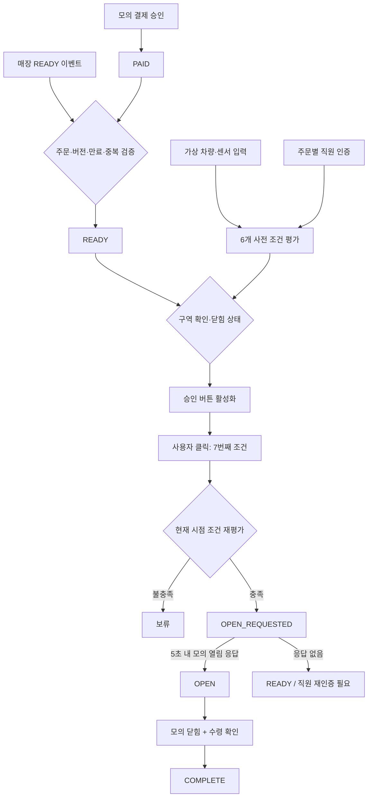

# 상태 전이와 승인 경계

## 중요한 경계

1. 매장 이벤트는 READY 상태까지만 변경합니다. 개방 함수는 이벤트 처리기에 전달하지 않습니다.
2. 승인 버튼의 활성화에는 아직 발생하지 않은 사용자 승인을 요구하지 않습니다. 클릭을 승인으로 받아 모든 조건을 다시 확인합니다.
3. 주문 상태가 OPEN_REQUESTED로 바뀐 후 같은 클릭이 재발생해도 새 요청을 만들지 않습니다.
4. 모의 차량 열림 응답은 OEM 제어기의 별도 응답을 재현합니다. 요청 전송만으로 OPEN이 되지 않습니다.
5. 주행 잠금은 차속·P단·UX 제한·차량 상태 유효성을 모두 봅니다.
6. 결제 키는 재시도마다 바꾸지 않습니다. 동일 주문·버전의 같은 작업은 같은 키와 결과를 사용합니다.
7. 이 APK의 결제·이벤트 기록은 메모리 내에만 있습니다. 서버/영속 저장 없이는 재시작·다중 장치 중복 방지를 보장하지 않습니다.

## 실제 연동의 선행 조건

| 연동 | 먼저 확보할 내용 | 완료 증거 |
|---|---|---|
| Pleos 차량 상태 | SDK·권한·차종 지원 목록 | AVD 및 허용 차량 로그 |
| Gleo | 앱 호출·NLU·주행 중 허용 범위 | 실제 발화→Intent→확인 흐름 |
| CarPay | 제휴 계약·테스트 계정·공식 인증 | 테스트 거래·취소·중복 콜백 검증 |
| SVM/초음파 | 데이터 형식·접근 권한·유효성 | 장애물·오염·단절 시험 |
| 테일게이트 | 제어 권한·인터록·오류 정의 | OEM 감독하 요청/응답/실패 시험 |
| UWB | 차량 수신기·앵커·보정·접근 권한 | 구역별 측위 오차·실패율 |

공개 SDK를 내려받을 수 있다는 사실과 각 권한을 승인받았다는 사실을 구분합니다.
