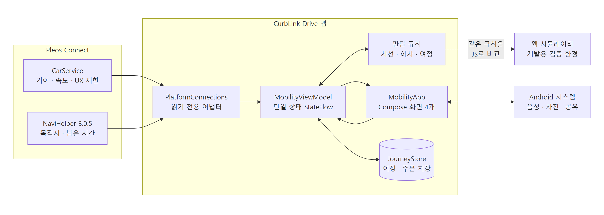
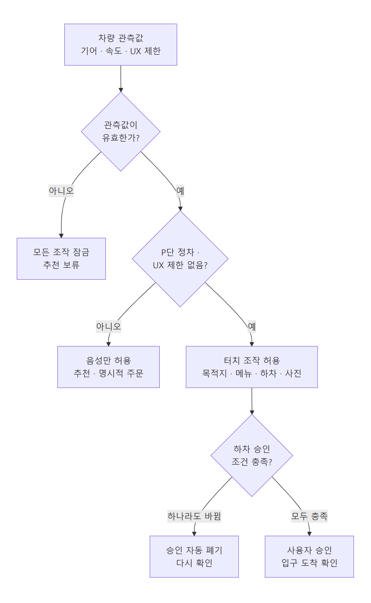

# CurbLink Drive 구조

0.5.2 기준(2026-11-15) 앱 구조입니다. 10/25 초기 구상(테일게이트 인계·모의 결제 상태 전이)은 [이 문서의 이전 버전](../../../blob/8b39d28/docs/ARCHITECTURE.md)에 남아 있으며 현재 앱과 다릅니다.

## 전체 구성

| 파일 | 역할 |
|---|---|
| `PlatformConnections.kt` | CarService에서 기어·속도·UX 제한을 1초마다 읽고, NaviHelper 이벤트를 받아 ViewModel에 전달. 차량을 제어하지 않음 |
| `VehicleContext.kt` | 차량 관측값의 유효성 판단: 출처 없음·기어 미확인·5초 초과 데이터는 무효 |
| `MobilityViewModel.kt` | 하나의 `MobilityState`를 StateFlow로 관리. 버튼·음성 입력을 상태 전이로 연결 |
| `LaneRecommendation.kt` | 차선별 비용 계산, 추천 차선·다음 행동·이유, 정보 만료 시 보류 |
| `MobilityModels.kt` | 하차 후보 평가(`MobilityRules.assess`), 도착 맞춤 메뉴 추천, 주문 확정 조건, 하차 승인 조건 |
| `JourneyTransitions.kt` | 실패 안내, 음성 의도 해석, 새 여정, 방향별 사진 첨부, 하차 지점 선택·이용 불가, 조건 변경 시 승인 폐기 |
| `JourneyStore.kt` | 진행 중 주문과 여정을 저장해 앱 재시작 후 복원. 사진·위치 승인은 복원하지 않음 |
| `MobilityApp.kt` | 네 탭 화면, 음성 명령, 시스템 사진 선택기, 공유창 |

## 안전 경계

- **관측값 유효 조건:** 출처가 있고, 기어가 확인되며, 5초 이내에 갱신된 값
- **하차 승인 조건:** 도착 · 공간 확인 · 램프 · 직원 · 장애물 없음

1. 차량 정보가 없거나 오래되면 조작을 막습니다. 시험 데이터로 대신 채우지 않습니다.
2. 화면의 "동승자 조작" 선택은 권한이 아닙니다. 운전석 화면의 주행 중 제한은 그대로입니다.
3. 주행 중 주문은 명확한 확정 문장일 때만 받습니다. 부정 표현이 섞이면 취소로 처리합니다.
4. 위치·사진·하차 지점이 바뀌면 이전 공유 승인과 하차 승인을 폐기합니다.
5. 실패(GPS·음성·사진·공유)는 진행 중인 주문과 사진을 지우지 않고 다음 행동을 안내합니다.

## 실제 연결 범위

| 연결 | 상태 |
|---|---|
| CarService 기어·속도·UX 제한 | 에뮬레이터 실제 서비스 연결 |
| NaviHelper 목적지·남은 시간·위치·도착 | 에뮬레이터 실제 서비스 연결 (실제 경로·ETA 수신은 미검증) |
| 시스템 사진 선택기 | 에뮬레이터에서 방향별 첨부 확인 |
| 차선·신호·정체 | 시험 입력 (실제 제공자 미연결) |
| 매장·메뉴·주문·결제 | 견본 데이터 (실제 전송·결제 없음) |
| 하차 시설 정보 | 견본 데이터 |
| 어라운드뷰(SVM), 도어·리프트 | 미연결 |

## 시험 구조

| 위치 | 내용 |
|---|---|
| `app/src/test` | 규칙 단위 테스트 84개 (Windows에서는 `run-domain-tests.ps1`로 JUnitCore 실행) |
| `app/src/androidTest`, `app/src/testSupport` | 에뮬레이터 외부 시험 드라이버·시나리오. 제품 APK에 포함하지 않음 |
| `simulator/js/*.test.cjs` | 웹 시뮬레이터 규칙 시험 5개 파일 |
| `scripts/check-vehicle-apk.ps1` | 제품 APK에 시뮬레이션·시험 코드가 없는지 검사 |
