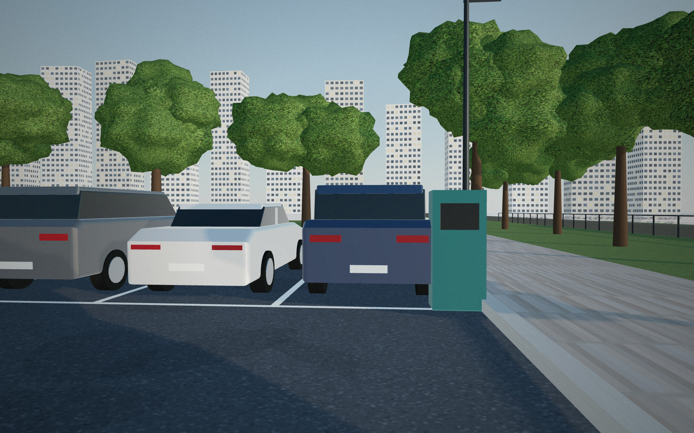
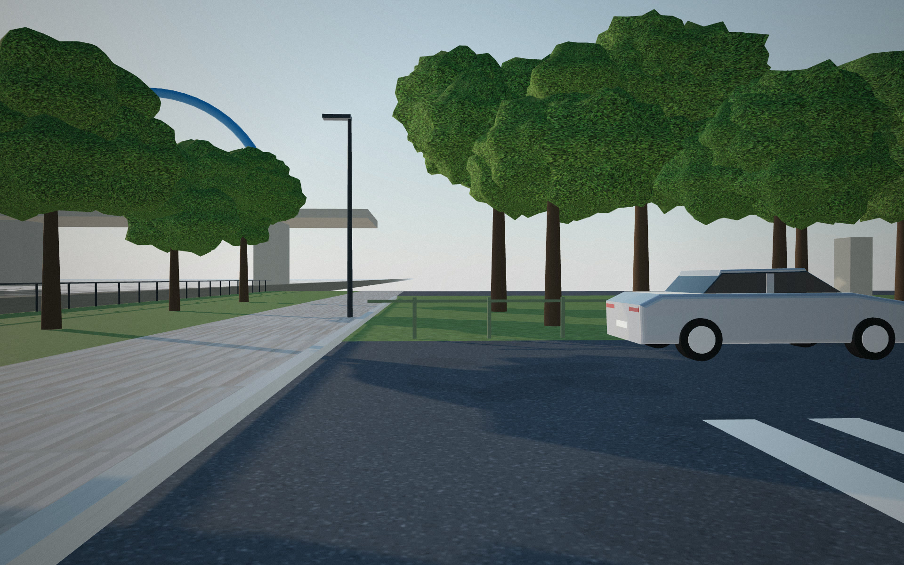
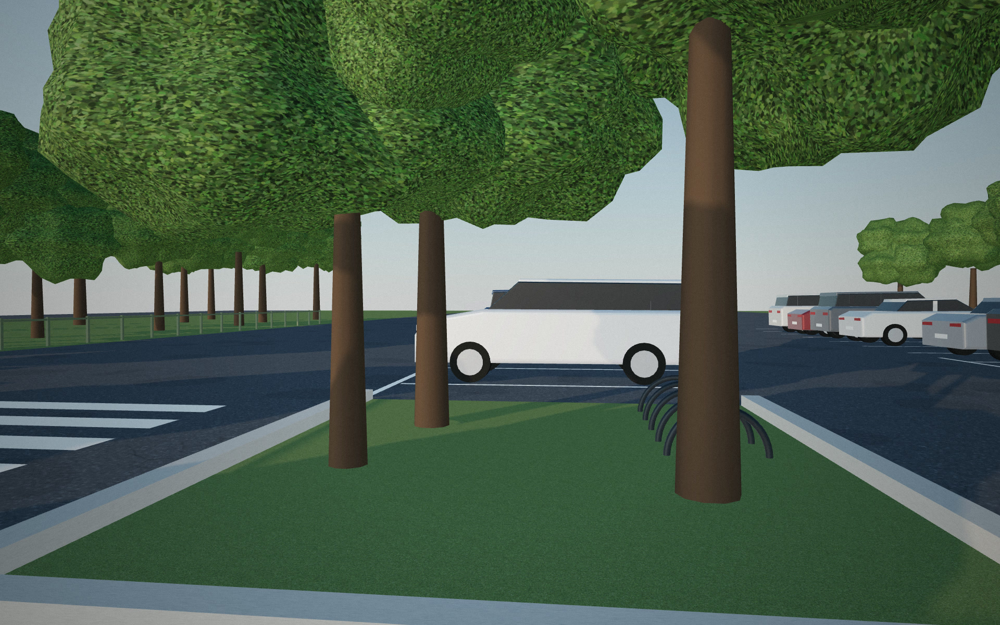
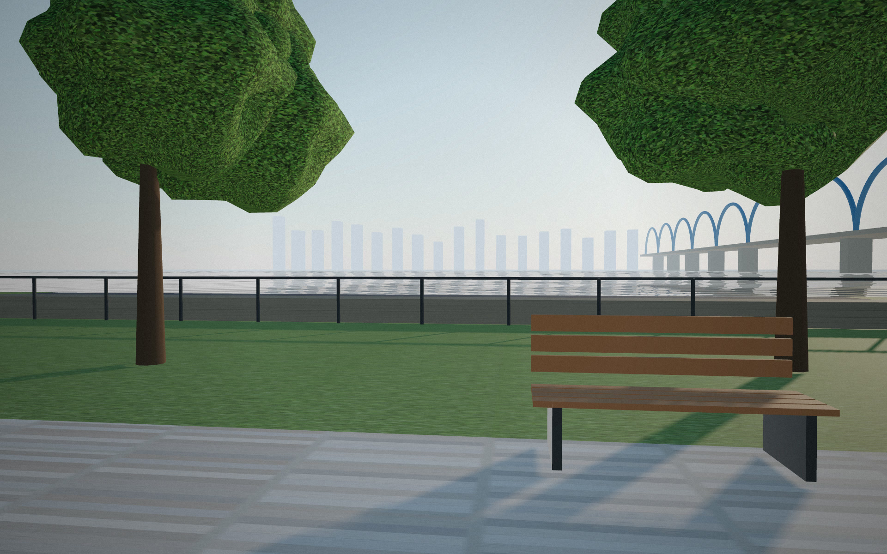

# 현장 인계 예시 이미지

시연 영상에서 **04 현장 인계** 화면의 전방·후방·좌측·우측 칸에 넣는 예시 이미지입니다.

> [!NOTE]
> 이 폴더의 이미지는 팀이 **3D로 렌더링한 가상의 공원 주차장**입니다. 실제 장소에서 찍은 사진이나 차량 카메라(어라운드뷰) 영상이 아닙니다. 앱은 이미지를 내장하지 않습니다. 시연 녹화 때 에뮬레이터 갤러리에 넣은 뒤, 앱의 각 방향 칸을 눌러 시스템 사진 선택기로 첨부합니다.

| 전방 | 후방 |
|---|---|
|  |  |

| 좌측 | 우측 |
|---|---|
|  |  |

## 장면 구성

한강공원 느낌의 강변 공원 주차장에 주차한 차 옆(눈높이 약 1.3m)에서 네 방향을 본 모습입니다. 늦은 오후 햇빛과 그림자를 넣었습니다.

| 파일 | 앱 칸 | 보이는 것 |
|---|---|---|
| `front.jpg` | 전방 | 맞은편 주차 줄, 정산기, 가로수, 멀리 아파트 |
| `rear.jpg` | 후방 | 주차장 통로와 횡단보도, 공원 울타리, 멀리 한강 다리 |
| `left.jpg` | 좌측 (운전석 쪽) | 빈 주차칸 옆 잔디 화단, 자전거 거치대, 다른 주차 차량 |
| `right.jpg` | 우측 (조수석 쪽) | 강변 보행로와 벤치, 난간 너머 한강, 건너편 아파트와 다리 |

번호판은 글자 없는 빈 판으로, 사람은 넣지 않았습니다.

## 다시 만들기

장면은 [scripts/example-photos/scene.html](../../scripts/example-photos/scene.html)에 코드로 들어 있습니다(three.js, 텍스처·모델 모두 절차적으로 생성). 아래 명령으로 네 장을 다시 렌더링합니다.

```powershell
python scripts/render-example-photos.py --channel chrome
```

다른 이미지를 쓰려면 같은 이름(`front`, `rear`, `left`, `right`, 확장자 jpg/png/webp)으로 이 폴더의 파일을 바꾸면 됩니다.

## 녹화

Pleos Connect v2.1.0 에뮬레이터를 켜고 실행합니다.

```powershell
python scripts/record-apk-demo.py --serial emulator-5554
```

스크립트가 이미지를 에뮬레이터 갤러리에 넣고, 앱의 각 칸을 눌러 이미지를 고르는 장면까지 녹화합니다. 결과는 `submission/video/curblink-apk-demo.mp4`(2560×1440)와 `submission/screenshots/apk/`에 저장되고, 사용한 이미지의 해시는 `submission/video/apk-verification.json`에 남습니다.
